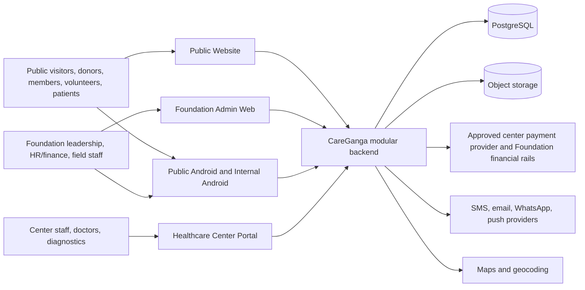
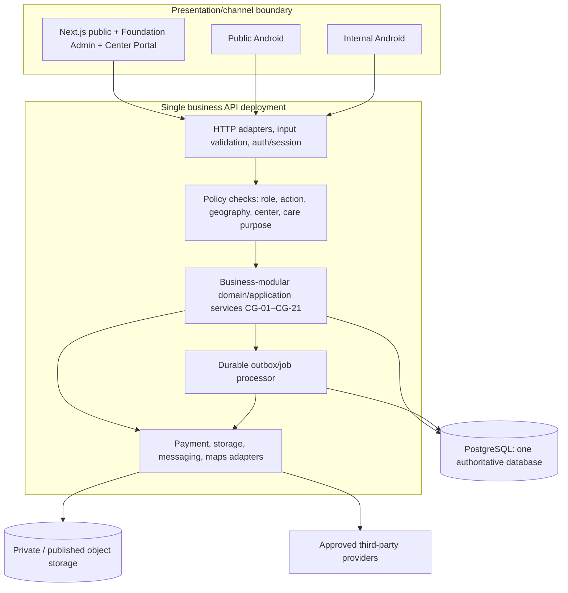
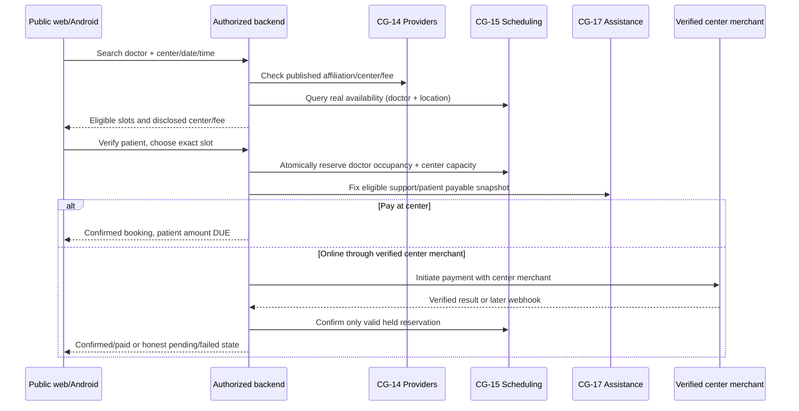

# CareGanga Foundation — Integrated Platform High-Level Design (HLD)

**Initiative:** `careganga-foundation-platform`  
**Product / repository:** CareGanga Foundation · `jasiqlabs/careganga`  
**Mode:** GREENFIELD — no running product, deployed infrastructure, selected runtime stack or existing implementation assumed  
**Authoritative location:** `specs/initiatives/careganga-foundation-platform/hld.md`  
**Working branch:** `feature/careganga-greenfield-prd-20261114`  
**Architecture baseline:** Product PRD `prd.md`, Git blob `b4f667db52bc0d64afeaf482c9b6e3e5fc376a0c` (Git blob identifier, **not** the Harness SHA-256 approval digest); BR/NFR documents in `docs/business-requirements/`  
**Shared methodology:** JASIQ Harness v2 reviewed/pinned `27ceb481aff168915d3c0ba776cf7aa08e71eb23` (14 November 2026)  
**Prepared:** 14 November 2026  
**Status:** **IN_REVIEW — updating for newest Harness database/pattern/background/mobile standards. Owner-delegated PRD/HLD authority is recorded in initiative.json, but resolver preflight and artifact-hash approval evidence remain NOT_RUN/PENDING; no Harness APPROVED claim.**  
**Approval integrity:** The owner explicitly authorized agent delegation for design review in this conversation. The current `initiative.json` opts in to narrowly scoped `OWNER_DELEGATED_DESIGN` for PRD/HLD. An approval must be truthfully attributed to the actual delegate as `DELEGATED_APPROVED` with the current file SHA-256, review evidence and validated resolver gate, never falsely as human/client sign-off. No resolver PASS or approval record is claimed yet; QA/UAT/release/merges require independent owner authorization.

## 1. Executive architecture decision

Build **one business-modular platform with a single authoritative backend and PostgreSQL database**, five client-facing channel experiences, separate confidential/public file treatment and minimal reliable integration workers. Start as a **modular monolith**, not 21 microservices. Keep boundaries explicit so accounting, scheduling, CMS, approval, staff and healthcare records cannot be duplicated by public/mobile interfaces.

**Proposed implementation families, to validate in Planning before dependencies are selected:**

- **Public Website + Foundation Admin + Healthcare Center Portal:** a shared **TypeScript/React/Next.js web codebase**, with distinct route areas, authorization and navigation; server-render/index **only approved public content**. Shared visual system and forms, separate permitted screens per role.
- **Two Android applications:** two distinct **React Native/Expo** distributions — Public Android and Internal Android — sharing domain-neutral design primitives, API contract and localization facilities without merging their identities or app/navigation permissions. iOS is **not contracted** by this PRD; any later iOS build requires explicit scope and App Store compatibility review.
- **Backend:** one **TypeScript/NestJS** application (HTTP/API, domain modules, validation, permission enforcement and integration adapters), independently deployable from web apps. A separated worker *process* from the same codebase may be used when background load justifies it, without a second business backend.
- **Persistence:** one managed **PostgreSQL** primary for transactional records and one appropriately secured object store for private documents and public media. Use built-in relational constraints and transactions; do not add another database for every module.
- **Side effects:** verified payment adapters and a **small durable database-backed outbox/job mechanism** for external notifications, documents and reconciliation. Introduce a dedicated queue/cache only if measured job throughput or latency requires it.
- **Operational posture:** managed hosting, backup, logs, health metrics and provider credentials in environment/secret management. Prefer a small number of runtime services and documented manual operational procedures over container orchestration or a service mesh.

These are **architecture proposals**, not assertions that any code or environment already exists. Exact versions, endpoints, schemas, indexes, library selection and deployment provider belong in module design/implementation.

## 2. Source authority, design drivers and constraints

### 2.1 Authoritative requirements

- [Product PRD](prd.md): FR-001–080, BR-001–016, A-01–A-21, product-wide N-01–N-12, and adopted business defaults D-01–D-25.
- [Master BR](../../../docs/business-requirements/00-MASTER-BUSINESS-REQUIREMENTS.md), [Foundation BR](../../../docs/business-requirements/01-FOUNDATION-OPERATIONS-BR.md), [Integrated Healthcare BR](../../../docs/business-requirements/02-INTEGRATED-HEALTHCARE-BR.md), [CMS/Channel BR](../../../docs/business-requirements/03-CMS-CHANNELS-BR.md), [Source Coverage Audit](../../../docs/business-requirements/05-SOURCE-TO-BR-COVERAGE-AUDIT.md), [NFR Baseline](../../../docs/business-requirements/06-NON-FUNCTIONAL-BUSINESS-REQUIREMENTS.md) and [Decision Register](../../../docs/business-requirements/04-TRACEABILITY-DECISIONS.md).
- Admin screenshot audit [reference](../../../docs/research/CAREGANGA-ADMIN-PANEL-SCREENSHOT-UIUX-AUDIT.md); UI reference records are design evidence, **not a working-code or production-data audit**.

The PRD's delegated business defaults govern the **provisional architecture scope**. Client sign-off, financial/provider credentials, statutory facts, regulated handling and release terms remain separate operational prerequisites.

### 2.2 Critical architecture drivers

| Driver | Source | Required architectural answer |
| --- | --- | --- |
| Five distinct user interfaces, one current state | FR-077–080, BR-001–002 | Reused backend contracts, shared validation, web channel areas and two distinct Android apps |
| One protected Foundation with geography + centers | FR-001–008, 042–046, N-01 | Central identity/roles, entity grants, organization/area/branch/center constraints and purpose-based health access |
| Common approval and final-authority model | FR-005–008, BR-003 | Shared approval decision workflow with owner-domain finalization |
| One financial authority and no duplicate money | FR-017–028, 034–036, 059–065, N-02 | Balanced accounting posting, linked source events, idempotent payment/settlement ledger handling |
| Doctor practices in multiple centers | FR-044, 047–053, BR-009–010, N-03 | One provider/doctor source, doctor-wide in-person occupancy plus center-specific offerings/capacity |
| Healthcare payment and subsidy are separate | FR-060–065, D-03–04, BR-008 | Center-collected patient payments distinct from Foundation liabilities/settlements |
| Patient/medical confidentiality | FR-049, 054–057, N-01/05 | Care-relationship authorization, private clinical documents, safe QR verification, access auditing |
| CMS controls public visibility, not owner data | FR-066–069, BR-005/012 | Publication gate and public safe projection from owner modules |
| Async provider errors must not corrupt core work | FR-018–019, 051, 070–072, N-04 | Transactional state and durable retry of external side effects |
| Performance/low operating complexity | N-06–11 and CG-BR-600 | Small deployment, bounded query/worker load, indexable public SSR, metrics and restore plan |

### 2.3 Assumptions and exclusions

- **One Foundation operating organization** with many Foundation branches and independently scoped **healthcare provider centers**. There is no agreed multi-customer SaaS tenancy model; do not add subscription/tenant billing infrastructure.
- A Foundation branch is **not** equivalent to a healthcare center. One healthcare center may have operating locations; doctor affiliations across centers do not clone the doctor.
- Real user counts, doctor/center inventory, daily bookings, peaks, hosting budget, languages beyond initial English, availability SLA, RPO/RTO and legal data retention remain **unconfirmed**. Apply P0 correctness/security regardless, treat numeric P1 targets as sizing proposals.
- Launch public transaction support is **doctor consultation booking only**. Lab service information is public; **internal** center test orders, sample processing and authorized reports are in scope. No e-pharmacy checkout, insurance claims processor, nursing/OT theater engine, structured EMR, family booking engine, ticketing or full offline synchronization is invented.
- Existing mockup doctor names, center names, ratings, fees, verification badges, UPI IDs, addresses, receipts and proportions are **sample data**, never production defaults.
- **No CI/GitHub Actions** in this project; use local/manual source and runtime review, genuine evidence and independent QA prior to release.

## 3. Context, actors and trust zones

### 3.1 High-level system context

**Trust boundary 1 — Internet/public:** Published marketing, service search, application and payment initiation can be available without staff authorization, with explicit response allowlists, user identity verification where appropriate, throttling and no private record enumeration.

**Trust boundary 2 — Authenticated personal:** Member/volunteer/employee/patient self-service grants **only that subject's** confirmed relationship and records; an association with a person record is not automatically clinical permission.

**Trust boundary 3 — Foundation operations:** Protected roles + action + organization/geographic/branch/assigned resource; a public role does not become staff by logging into another channel.

**Trust boundary 4 — Healthcare operations:** Center/operating-location context + professional/role scope + permitted treatment purpose. A center user cannot browse another center's patient data, bank details, internal cases or settlement records.

**Trust boundary 5 — Infrastructure/providers:** Database, private object files, payment webhooks and internal workers are server-only. External provider messages must be authenticated and treated as **untrusted until verified**.

## 4. Proposed runtime/container view

**Logical channels vs deployables:** The three web experiences can share one frontend project while using independently protected routes/layouts. Two Android **app packages** remain independently releasable. Backend module boundaries are **internal**, not microservice deployments. Private medical and employment documents do not become public CDN assets merely because they are in the same object storage account.

### 4.1 Interface responsibilities

| Interface | Owns | Does not own |
| --- | --- | --- |
| Public website | SEO-friendly content presentation, published directory, public registration/donation/doctor booking and verified self-service | Business approval, fee eligibility, real appointment inventory, payment verification |
| Foundation Admin web | Authorized operational/configuration screens, policy, approval and CMS control, network-wide reports | Independent ledger or shadow domain masters |
| Center Portal | Scoped own-center provider management, doctor scheduling, patient reception, internal lab work and center collections | Foundation-wide clinical records, central settlement authority, unverified publication |
| Public Android | Public and self-service flows, verified patient and member/donor interactions | Foundation/Admin role shortcuts |
| Internal Android | Field GPS/photo evidence, attendance/leave/claims/requests and assigned approvals | An unconstrained replica of entire Admin or unverified offline writes |
| Backend | Domain ownership, authorization, validation, state/transaction consistency, side-effect coordination | HTML-only business validation or fixed sample UI data |

### 4.2 API and contract strategy

Use a coherent versioned **HTTP JSON API** with shared typed contracts, centrally enforced authentication, validation, pagination/filtering and consistent explicit error semantics. Public published queries are separate from authenticated private queries. Each channel calls the same domain application operations; authorization is re-evaluated on every protected request, not trusted to mobile navigation or page-level controls.

Only architecture-level contract classes are fixed here: **public-anonymous, public-authenticated, Foundation-private, center-private, privileged-operations, signed-provider-webhook/internal job**. Exact URLs, DTOs, table structure and token format belong to DLD.

## 5. Business boundaries and conceptual data ownership

A **business owner module owns its lifecycle, data invariants and write operations**. Other modules consume typed application facades/commands/queries, reference IDs, or validated domain events, **never write through another module's repository or tables**. Modules may be grouped by business area for code organization without changing 21 CG owner IDs.

| Owner | High-level responsibility and authoritative records | Primary consumers |
| --- | --- | --- |
| **CG-01 Identity & Access** | Identity, sessions, roles, action grants, area/branch/center grants | All protected modules |
| **CG-02 Foundation Structure** | Foundation profile, internal branches, geography, departments, committees | Staff, projects, budgets, admin reporting |
| **CG-03 Applications & Approval** | Application case, steps/decisions, verification and finalization references | Registration, finance, CSR, providers, payroll |
| **CG-04 Members & Volunteers** | Participant relationship, membership plan/term/fee entitlement, volunteer affiliation | Public self-service, programs, referrals |
| **CG-05 Projects & Field Work** | Project, event/activity, tasks, field visit/GPS evidence metadata | Beneficiary help, budgets, impact |
| **CG-06 Beneficiaries & Aid** | Private beneficiary relationship, aid events, distribution details | Projects, inventory, reports |
| **CG-07 Fundraising & Donations** | Campaign/donor donation intent, verified transaction status and receipt source | Finance, CMS, donor portal |
| **CG-08 CSR & Funding** | CSR partner, proposal, commitment, funding split and allocation intent | Project/finance/budgets |
| **CG-09 Finance & Budgets** | Chart of accounts, posted entries, bank/cash ownership, voucher/invoice, fund/project allocations | All monetary owners and financial MIS |
| **CG-10 HR & Employees** | Employee relationship, attendance, leave, lifecycle/letters | Internal app, payroll, approval |
| **CG-11 Payroll** | Salary policy, period calculation/run, payment batch/payslip source | HR, finance, documents |
| **CG-12 Inventory & Vendors** | Items, vendors, stock receipt/issue/adjustment, material request/fulfillment | Beneficiaries, projects, rewards |
| **CG-13 Referrals & Rewards** | Attribution, points ledger, ranks, redemption and reward entitlement | Members, inventory, reporting |
| **CG-14 Healthcare Network** | Provider/center/branch, doctors, professional verification, affiliation, center-specific price/services | Directory, scheduling, CMS |
| **CG-15 Patients & Appointments** | Patient ID/identity and consent references, doctor availability/holds/booking/queue | Public/center, billing, reports |
| **CG-16 Diagnostics** | Tests/packages, internal lab order/sample/report release | Center portal, patient report access, billing |
| **CG-17 Healthcare Assistance & Settlement** | Benefit policy/version, patient charges and center-collected status, Foundation liability, settlement/adjustment | Booking, finance, provider reports |
| **CG-18 CMS & Publication** | Editorial sections, public presentations, publish visibility/revision | Public site and app |
| **CG-19 Docs, Communication & Support** | Private/public file metadata, templates/generated documents, deliveries, tickets | Every owning workflow |
| **CG-20 MIS & Analytics** | Scoped reports, saved views, aggregate/statistical projections, scheduled reports | Admin, center, authorized staff |
| **CG-21 Platform & Audit** | System settings, external integration configuration references, audit, backup admin | All services |

### 5.1 People and confidentiality model

An **identity account** can associate with several person/business relationships (member, volunteer, employee, beneficiary, patient or doctor) only after appropriate verification; association is **not permission inheritance**. Clinical patient records and staff bank/payroll information have purpose-specific controls. A doctor can have one verified professional profile and many approved affiliations; appointments reference **one actual center location**.

Where the same contact number appears in multiple contexts, avoid auto-merging protected records. Record consent and explicit verification for sensitive associations; audit authorized access to sensitive reports and private documents. Public searches show only publication-approved fields.

### 5.2 Foundation branch vs healthcare center

Foundation organization geography and internal branch hierarchies come from CG-02; provider businesses, their locations and operational scopes come from CG-14. A geographic link may support reporting but **does not share staff/financial/clinical visibility automatically**. CG-01 policy validates the actual actor's assignment across these distinct boundaries.

### 5.3 Cross-module dependency rules

- CG-03 can record verification/approval, but **only the owning module applies the final business transition** after validating current state.
- CG-09 is the **Foundation accounting system of record** for recognized Foundation money; domain modules carry references to its accepted entries. CG-17 owns separate center collection/benefit source records. A center merchant's patient receipt must **not be automatically posted as Foundation cash**.
- CG-19 generates from authorized source data, not independently edited totals; a PDF/reference/QR is a *projection*, not the source booking or payment.
- CG-18 publishes a safe **field allowlist/projection** of approved provider/doctor/project data; editors cannot mutate clinical registration, schedules, member activation or billing through a published page.
- CG-20 reads authorized domain contracts or restricted read models; a report writer/export/scheduled job must not bypass actor scope or replicate conflicting ledger totals.
- CG-21 audit is appended during/alongside protected business transitions with correlation and redaction; no user-visible “success” without confirmed business state.

### 5.4 Scenario-driven architecture-pattern selection (latest Harness gate)

Patterns are chosen to protect **real variation or invariants**, not to maximize classes. Per `standards/ENGINEERING_STANDARD.md`, these are architectural seams; exact interfaces, constraints and errors belong to a REQUIRED module DLD.

| Scenario / owner | Minimal chosen seam and invariant | Alternatives, including doing nothing | Extensibility / measurable trade-off |
| --- | --- | --- | --- |
| Membership, branch, provider, finance and payroll approval routes — CG-03 | **Composed orchestrator plus guarded state transitions**, with source-domain finalization. One authorized final outcome; correct reviewer scope | Copy process logic independently (simple initially, duplicate approvals); **Template Method** base inheritance (incompatible step ordering/transaction boundaries) | New approved route is validated process configuration plus owner finalizer, not a second approval system; audit every transition and monitor configuration count |
| Fixed/percentage/capped/exceptional healthcare support — CG-17 | Pure versioned **policy/Specification object**; **Strategy** only for genuinely distinct approved calculation algorithms. Accepted fee snapshots never silently change | Hardcode per-portal conditions (simple but divergent); unrestricted rule engine (unnecessary finance and security risk) | Add allow-listed policy variant without changing old bookings; verify 50/50 and approved full-support cases, calculation latency and authorization |
| Doctor booking holds, approval/financial lifecycle — CG-15/03/17 | Explicit **state machine** via guard/transition functions inside cohesive services, plus DB transactions. Prevent invalid transitions and cross-center doctor overlap | Independent status flags (cheap but inconsistent); state class for each status (unnecessary class explosion) | New approved state requires guarded transition/negative tests, not a second scheduler; measure conflicts and rollback |
| Center-specific and Foundation payment/messaging providers — CG-07/17/19/21 | **Adapter** at provider boundary, optionally small typed allow-listed **factory/registry** only when multiple real providers exist. Domain state independent of SDK | Direct provider SDK calls in business logic (fast start, unsafe coupling); generic dynamic plugin framework (unneeded) | Add approved provider through adapter, unchanged financial contract; measure retry/timeout and provider-specific failures |
| Approval + finance + stock + rewards business effects — CG-03/09/12/13 | Scoped **facades** and existing PostgreSQL transaction as **Unit of Work** for same-DB writes. One authoritative stock/ledger/points effect | Direct cross-owner repository writes (initially easy but violates ownership); universal transaction/saga framework (overengineered) | New consumer calls typed facade; keep short locks, idempotency, audit and scope tests |
| Receipt/document/notice/report and settlement side effects — CG-19/17/20 | **Domain event reference + transactional outbox** only when after-commit delivery must survive failure; ordinary UI view updates can be simple functions | Synchronous network calls in DB transaction (long locks); fire-and-forget callbacks (lost work); Kafka (premature) | Bounded idempotent worker, measure zero-job idle queries, retries, provider bytes, dead work |
| Publish approved projects/doctors/centers — CG-18/05/14 | **Publication read projection + source owner facade**, explicit published-field allowlist. A CMS editor cannot change professional/financial truth | Editable duplicate CMS master (drift); separate search service/event-store without proven volume (operational cost) | Add approved public field via owner contract, no draft/medical leak; measure freshness |
| Routine profile/catalog/department CRUD — CG-02/10/14 | **Simple application service with scoped queries**; deliberate *no new pattern* decision | Generic repository framework (hides locks/queries); Strategy+Factory+Template Method stack (excessive abstraction) | New normal field should not require new handler classes; preserve clear validation and tests |

**Explicit negative decisions:** No mandatory inheritance-based Template Method; no speculative Abstract Factory, Saga/Process Manager, full CQRS/event-sourcing, distributed transactions, business-rule scripting or microservice-per-module. Add a pattern only if another *approved* variant actually warrants it. Evaluate number of abstractions, query/lock cost, cross-channel parity and compatibility before DLD approval.

## 6. Consequential business interactions and transaction boundaries

### 6.1 Registration/approval/activation (FR-001–011, 020, 042–044)

1. Owning module records a **draft or submitted** business record and immutable-enough supporting-document references.
2. CG-03 routes the application through the configured per-process hierarchy and validates reviewer action/scope and document decisions.
3. At **final approval**, owning domain applies its guarded state transition (member ID, branch activation, provider verification, employee relationship, CSR eligibility). Where a fee is required, use **verified payment status**, not initiated checkout, as an explicit condition.
4. Store final effect and approval correlation in one local transaction where feasible; emit a durable event for certificates, welcome messages and publication eligibility. Retries/parallel decisions must not repeat IDs or payments.
5. A published card is separately enabled by CG-18 after operational verification. An existing provider activation is not a CMS publication shortcut.

**Concurrency/error:** Version/status preconditions, unique approved identifiers, approval decision and final effect idempotency. Returned/rejected decisions leave reason/history; a revoked reviewer cannot replay an old decision.

### 6.2 Foundation finance and other source payments (FR-017–028, 034–041)

- **Foundation accounting** posts accepted balanced monetary entries in one controlled transaction. Every external source event has one business correlation/reference and an idempotency guarantee.
- **Donation/campaign/member payment** remains pending until verified provider confirmation; capture linked cash receipt, donor/membership effects and financial posting without double credit or duplicate PDF.
- **CSR** tracks proposal/commitment/receipt/allocation/expense separately. An approved pledge is **not** cash/bank income.
- **Expense/reimbursement**: staff claim → CG-03 decision → CG-09 payable/voucher → verified payment → accounting. Status changes neither duplicate the expense nor make it paid prematurely.
- **Payroll**: approved employees and attendance → draft calculation in CG-11 → authorized verification/payment batch → CG-09 financial posting → private payslip and notification. Repeated runs do not pay employees twice.
- **Inventory/rewards**: a fulfillment or redemption may require an atomic points/stock result plus a linked accounting/assistance outcome. Never issue a reward twice or show negative available stock from concurrent last-unit requests.
- **Corrections:** Apply tracked reversal/adjustment records, not silent edits to final journal/receipt/settlement history.

**Outbox and payment callbacks:** Persist verified business transition + outbound work item atomically; process notifications/docs later. Authenticate third-party callbacks, track duplicate/replay and resolve “provider succeeded, response lost” via reconciliation rather than issuing a second collection. Exact DB isolation, journal postings and retry algorithm belong to DLD.

### 6.3 Healthcare provider, patient, booking and doctor's multi-center occupancy (FR-042–054)

**Authoritative inventory:** CG-15 owns capacity and reservations. CG-14 owns doctor, affiliated centers and valid fee associations. Center-first and slot-first search are **two projections of the same actual schedule**, not two booking services.

**Key invariants:**

- The **same doctor cannot be confirmed for conflicting in-person appointments at different centers**, even when each center shows an apparently free slot. Center-specific capacity and doctor-wide time/compatible-location occupancy are both checked at the final guarded reservation decision.
- When more than one center fits the selected time, present the eligible center choice; the patient sees and accepts the exact physical location and fee **before payment**. Never infer a remote center from a marketing map or display a stale price.
- Use a **bounded temporary reservation/hold policy** for online checkout where payment completion is asynchronous. Holds release on expiry/failed attempt; late verified success is reconciled without overbooking, with an explicit refund/manual recovery path if the slot can no longer be secured.
- Confirm the appointment separately from **paid/due**. Pay-at-center may yield a valid booking and a remaining patient amount due. Center check-in/collection changes the correct money state; cash recorded as center-owned collection, not Foundation income.
- A booking captures the accepted doctor-center fee and applicable support policy version. Later schedule, eligibility or fee change affects future quotes, not silently an existing receipt.
- Patient identity verification, own-report access, staff care-assignment and QR lookup are separate permissions. Public QR returns minimal booking verification; private reports require authenticated authorized identity and relationship.
- Cancellation/rescheduling and center/doctor suspension trigger accurate capacity, due/refund, communication and audit outcomes; background notices do not become the authority on the booking state.
- Clinical reports from CG-16 are private and professionally released; a generic appointment checkout does not create an electronic prescription or general medical record subsystem.

### 6.4 Healthcare contribution, center collection and Foundation settlement (FR-059–065)

1. CG-17 evaluates configured eligibility and fee snapshot for actual service, provider, patient/benefit decision and effective period. Standard eligible consultation example: **50% Foundation / 50% patient**; 100% requires protected explicit exception approval.
2. A center collects its **patient payable** through that center's verified merchant or permitted on-site collection; if merchant credentials are not verified, online payment is not offered.
3. CG-17 records the **Foundation's support obligation** distinctly from center-collected patient money. It reconciles a valid service, approved contribution, provider dues and center-level adjustments/refunds.
4. Finance CG-09 recognizes only **Foundation-owned cash, liabilities and approved disbursements**; payment to center for Foundation support is a separate approved/reconciled settlement. Reports may display gross center collections without representing those funds as Foundation bank income.
5. Monthly settlement is an approved business default. Multiple patient bookings may aggregate into one settlement with traceable detail, approval, partial payments, correction, dispute and audit.
6. External center payment callbacks must authenticate merchant/provider and map to their exact transaction. A verified callback for Center A must not mutate Center B collection or Foundation financial account.

**Boundary risk:** No transfer/split-payment feature is assumed unless the actual center merchant agreement supports it and the client has authorized it. Never assume one Foundation Razorpay key can accept payments *on behalf of* every independent center.

### 6.5 CMS publication, search and reporting (FR-066–074)

- **Public data projection:** CG-18 determines which approved Foundation projects, impact summaries, campaigns, teams, centers/doctors, service information and legal documents may appear. The underlying modules supply authoritative current status, fees and eligibility.
- **Search:** Indexed, paginated query against permitted published data; no blind cross-center private search. Public website renders indexable valid content, not unverified draft or clinical data.
- **Live appointment information:** Schedule and fee are fetched from authoritative CG-14/15/17 APIs at selection/confirmation rather than trusted from a stale public page cache.
- **Reports:** Reuse authorized domain read APIs or controlled read projections for cross-domain aggregation. Administrative filters/exports and scheduled deliveries must re-check recipient's effective scope; long reports may execute asynchronously with bounded resource use.
- **Messages and documents:** Generate from recorded owner state using CG-19; preserve template version, audience, source ID and delivery state. Source change may require a new version rather than rewriting historically issued artifacts.

### 6.6 Failures/unknown-success and side-effect isolation

Classify responses consistently: loading, confirmed empty, validation error, unauthorized, forbidden, conflict, expired, offline, dependency unavailable, **pending verification/unknown completion**, final success, and partial external delivery. UI must display the actual backend outcome. Do not return `200` or an empty success payload when the database write, notification dispatch, payment, approval or provider call has failed.

- Business transactions succeed or fail within a controlled DB boundary. External messages/receipt generation are **durably retried** and may be marked queued/failed without rollback of already accepted core business state.
- Payment and settlement state remains pending if provider response cannot be confirmed; reconcile using authenticated provider status and idempotent events.
- Avoid unbounded background polling, “always-on per-center” jobs or full-table scans; schedule controlled jobs only when needed. Work queues must have retry limits/visibility and operational alerts for repeated failure.
- Reports, file processing, notifications and background reconciliation must not starve appointment/finance/approval requests; separate worker execution or resource budgets if measurement demonstrates need.

## 7. Security architecture and data governance

### 7.1 Authentication, authorization and scoped queries

- **Authentication:** Private administrative roles use secure credentials, session revocation and required privileged MFA as the adopted policy; public patient/member verification uses approved user authentication and OTP where applicable. Authentication is an account fact, not a broad permission grant.
- **Central policy enforcement:** At each protected application operation, authorize **subject + permitted action + resource + geography/branch/center relationship + purpose**. Apply it to list/search/detail, foreign selectors, documents, exports, generated PDFs, side effects and mutation. Deny by default and audit privileged attempts.
- **Scope propagation:** Accepted scope is derived from trusted assignments, not unchecked client-selected IDs. Switching center/geography in UI filters does not widen access; queries and reports carry server-proven scope.
- **Clinical boundary:** Professionals see appropriate patients/visits/reports through a permitted center and treatment relationship, and Foundation oversight reports expose only what policy allows. A Foundation finance reviewer need not see full clinical notes.
- **Person identity boundary:** Linking verified contact, employee, volunteer, donor and patient relationships is explicit, never an automatic medical-data entitlement.
- **Files and exports:** Private object keys, signed short-lived authorized access, file scan/type/size checks, source-linked access controls, safe exports and public approved-media separation; audit sensitive reads.
- **Public QR/verification:** Return narrowly defined validity/status and non-sensitive appointment context, throttle guessing and never disclose a raw report or patient record via an opaque code alone.
- **Web/mobile sessions:** Secure cookies/tokens, appropriate CSRF/CORS protections, device-safe cached content, expiry/revocation and restricted credential handling, never embedded gateway credentials.

### 7.2 Privacy, compliance and audit

Classify records at minimum into **public-published**, internal general, restricted financial/HR, restricted identity/beneficiary, and **highly restricted healthcare**. Every audit/log/analytics/export has an explicit permitted category and scope. Avoid logging diagnoses, identity images, OTPs, secrets, card tokens and private file URLs. Audit actor, time, decision, entity reference, scope and authorization-sensitive policy changes.

Data retention, legal/clinical authorization and tax/GST/80G validity require Foundation legal/accounting/clinical input. Design provides controlled retention/archival, access log, consent/reference and export facilities **without claiming automatic certification under any law**.

## 8. Database and storage strategy

### 8.1 Coherent relational system

PostgreSQL is the **transactional source of truth**. Use clearly module-owned records and write facades, foreign-key/reference integrity, uniqueness for business identifiers, appropriate indexes, version checks and transactions for money/booking/stock/approval. Conceptual groups: identities/grants; Foundation geography/branches; approvals; membership/person relationships; projects/field/aid; donations/CSR; Foundation accounting and budgets; HR/payroll; inventory/rewards; healthcare providers/doctors; patient/schedule/bookings; diagnostics; healthcare funding/settlement; CMS/publications; notifications/documents; audit/jobs.

**Not chosen:** separate center databases, separate Foundation and healthcare financial systems, per-channel databases, one generalized everything table, microservice database per CG module, cross-module direct SQL updates, automatic speculative data warehouse.

Module boundaries should be enforceable in code review and explicit data access interfaces. Database physical schemas can remain simple; DLD decides table grouping and exact constraints. It must preserve explicit **Foundation branch vs provider center** isolation and doctor-wide plus center-wise scheduling constraints.

### 8.2 Transactions and idempotency

- Use short relational transactions around one authoritative state change plus required local audit/outbox/financial effects where feasible.
- Disallow duplicate business effects via source identity and appropriate uniqueness/status/version checks; prefer DB-enforced invariants over frontend-only checks.
- Use a robust reservation/capacity strategy that prevents conflicting same-doctor time intervals across locations and center capacity exhaustion; exact locking/exclusion approach belongs to CG-15 DLD.
- Do not hold database locks over external provider network requests; use pending state, reservations and subsequent verified reconciliation.
- Financial posting uses precise money values, transaction references, balanced debit/credit rules and immutable correction links. No fake exactly-once guarantee from an external webhook.
- Cross-module interactions within this single process use typed operations, with decisions applied at clear ownership boundaries; remote side effects are asynchronous/retried.

### 8.3 Private files, public media, backups

Use object storage for uploaded medical/identity/employee/bill files and generated documents. Make **private by default**, with server-authorized temporary access for permitted persons. Public editorial/center media is explicitly approved and may use cache/CDN. Apply type/size checks and antivirus/content scanning where appropriate. Keep audit/attachment metadata and source links in PostgreSQL; do not store unbounded binaries in transactional rows.

Use provider-managed encrypted storage/backup where available, retention/snapshot controls and documented restored-data verification in an isolated recovery environment. Production restoration is Foundation-operator-only; healthcare center staff can request support, not restore the global database.

## 9. Deployment and operating model

### 9.1 Initial logical production layout

| Runtime | Initial deployment shape | Scale/operations notes |
| --- | --- | --- |
| Public/Admin/Center Web | One Next.js deployable with route/isolation boundaries, public SSR and private authenticated areas | Scale web serving independently of backend if measured |
| Business backend | One NestJS/TypeScript service with module facades and API/webhook adapters | Single shared authority; no need for microservices per domain |
| Background jobs | DB-backed durable outbox/worker in controlled service; optional separate worker **process** from same codebase | Limit concurrency; offload PDFs, mail, report jobs and reconciliation |
| PostgreSQL | Managed primary, pooled access, backups, restricted credentials and restore procedure | Monitor DB size, query plans, connection count, slow queries and egress; no unbounded polling |
| Object storage | Private document bucket/prefix and approved public-media content | Scoped signed access, retention, bandwidth/media lifecycle |
| Android | Two independently built/signed Play Store applications | Shared business client contracts, verified supported libraries/SDK and mobile release compatibility |
| Third-party integrations | Foundation settings for payment provider(s), communications, maps/location | Signed callbacks, credentials, retries, provider health and paid-service budgets |

**Environments:** Maintain a safe local/dev and non-production verification environment distinct from production for payments, sample medical data, migrations and restore drills. A costly permanent staging fleet is not assumed. A feature/release branch is not proof of a deployed environment.

**Android release governance:** At each release, verify currently accepted Google Play target SDK level, 16-KB native page-size compatibility where applicable, supported React Native/Expo/Gradle/NDK/dependency versions, Android manifest permissions, signing, privacy declarations and store submission constraints. Pin compatible versions in implementation and document native dependency upgrade/rollback. Do not reuse an unsupported old library simply because a sample project does.

**Web SEO:** Public published pages may be indexed by default; all admin, patient, member-private, receipt, private file and draft URLs must be non-indexable, even if their route exists. CSR/healthcare public pages show only accurate approved publication fields.

### 9.2 Availability, speed and capacity planning

All numbers below are **PRD-proposed P1 starting targets**, not measurements or contractual client commitments:

| Quality concern | Proposed allocation/evaluation | Ownership |
| --- | --- | --- |
| API latency | Common read/write p95 ≤1 second at agreed representative mix | Backend/modules + DB |
| Scoped listings | p95 ≤1.5 seconds for searches at agreed volume | Domain query facades, DB indexing, pagination |
| Public UX | Web LCP ≤2.5s, INP ≤200ms, CLS ≤0.1 using realistic devices/network | Public web rendering, media, caches |
| Initial load model | 100 concurrently active sessions; explicit last-slot race and cross-center doctor race | Shared backend/DB + web/mobile test |
| Public publishing freshness | Candidate ≤60s after approval; booking inventory checked live | CMS projection/cache + CG-15 |
| Availability | Candidate 99.9% monthly production service availability | Hosting/integration/operations |
| Backup/recovery | Candidate RPO ≤1 hour; RTO ≤4 hours after recovery design/sizing | Managed DB/backup and operators |
| Accessibility | Aim WCAG 2.2 AA for web; usable Android forms, large text and low connectivity | Shared web design + Android apps |

**Capacity unknowns requiring inputs before final HLD approval:** active users, peak concurrent center sessions, centers/doctors, visits/day, lab reports and object volume, search growth, messaging volume, payments/day, gateway ownership, peak time windows, hosting budget/support hours. Architecture must remain safe at unknown scale; do not claim benchmark performance until measured.

### 9.3 Practical cost and bandwidth discipline

- Prefer managed relational storage and application deployments that the project team can support; avoid Kubernetes, Kafka, Elasticsearch, separate Redis/cache, service meshes or multi-region writes at first.
- Index/paginate public and admin searches, cap API payloads, optimize media/resolutions and avoid unnecessary polling/mobile refetch.
- Use event-driven durable work rather than a continuously scanning import or notification worker; apply backoff, failure status and bounded concurrency. Keep reports/scheduled exports controlled.
- Add CDN for **approved public media** and public page caching where it improves measured load; do **not** cache individualized private medical/finance responses in a shared public cache.
- Monitor database egress/bandwidth, network traffic and worker frequencies, not just CPU. Introduce separate read replicas/search infrastructure only if profiling justifies expense and operational effort.

### 9.4 Observability, backup and recovery

Structured request/activity IDs connect UI errors to backend, domain action, provider callback and background job without leaking PII. Monitor API p50/p95/p99, errors, booking conflicts, pending payment reconciliation, outbox depth/retries, DB pool/slow queries and egress, failed report generation, storage failures and backup results. Provide operator-visible alerts and a concise runbook for payment mismatch, patient booking dispute, delayed messages, provider suspension and recovery.

Verify a real backup restore in an isolated non-production environment before production go-live. Backups and test results are operational evidence, **not something a Markdown design can mark passed**.

## 10. Major alternatives and decisions

| ID | Adopted architectural direction | Alternative considered | Rationale / cost |
| --- | --- | --- | --- |
| H-01 | Modular monolith, one authorized backend | 21 microservices / independent healthcare backend | Lower cost, transactional integrity, less duplicate business state and operations |
| H-02 | One PostgreSQL relational source | Per-center/per-module databases or document-only DB | Booking/ledger/approval consistency, clear authoritative joins and integrity |
| H-03 | Explicit domain ownership and typed facades | Direct module-to-module table writes | Maintains boundaries, testability and future extraction ability |
| H-04 | Shared web project with protected public/admin/center areas | Three unrelated web stacks | Reuse and consistency; risk of accidental data leakage mitigated by backend auth and separate route/security contexts |
| H-05 | Two Android app packages, shared minimal client code | One app with mixed public/admin login | Matches contract and smaller end-user navigation; avoid shared privileged bundles |
| H-06 | Durable database-backed outbox for critical external side effects | Fire-and-forget notifications or mandatory Kafka/Redis | Protects money/booking correctness without expensive queue infrastructure |
| H-07 | Real-time authoritative booking at confirmation | Independent center/site calendars | Prevents cross-channel and cross-center conflict; requires careful transaction design |
| H-08 | Center-specific patient money, Foundation-only liability posting | Auto-credit all center collections into Foundation cash | Fits delegated payment policy, avoids false ledger balance and unapproved money routing |
| H-09 | Public published projection + private source records | CMS copies all provider/project/fee/business tables | Correctness, governance, no hardcoded shadow fees |
| H-10 | Small managed deployment, measured scaling | Premature complex orchestration or public-search cluster | Practical operating budget and maintainability |

**Reasonable technology alternatives not yet finalized:** Another well-supported TypeScript HTTP framework or responsive web bundler is acceptable if it preserves the same security, SEO and maintainability. Managed Postgres and relational constraints are an important architecture choice; exact managed vendor/runtime region requires operational approval. Versions/SDK must be reverified at development time rather than blindly selected now.

## 11. Architecture-to-requirement allocation and risk coverage

| PRD / business cluster | Architecture owner/decision | Relevant NFR gates and risk |
| --- | --- | --- |
| FR-001–008, BR-001–005 | CG-01/02/03; H-01/03, scope and approval orchestration | N-01/N-05/N-11; privilege and geography escalation |
| FR-009–016, 039–041 | CG-04/05/06/12/13 + CG-03/19; shared identity and stock | N-01/N-02/N-09; identity collisions, duplicate aid/rewards, privacy |
| FR-017–028, 034–036 | CG-07/08/09/10/11 + H-02/06 | N-02/N-04/N-11; finance accuracy, funds vs commitments, payroll/stock once |
| FR-029–033, 037–038 | CG-10/12; guarded role/stock/claim facades | N-01/N-02/N-09; salary leak, leave and stock concurrency |
| FR-042–046 | CG-14 + CG-03/18; provider/doctor verification and public allowlist | N-01/N-05/N-10; forged badges and cross-center access |
| FR-047–054, BR-009–010 | CG-15/14/17 + H-07 | N-03/N-04/N-09; doctor overlapping in-person bookings, stale center info |
| FR-055–058 | CG-16 + CG-14/17/19; internal lab order/report | N-01/N-05/N-10; professional report release and unauthorized lookup |
| FR-059–065, BR-006–008 | CG-17/09 + H-06/08 | N-02/N-04; center merchant segregation, refunds, Foundation liability |
| FR-066–074, BR-011–016 | CG-18/19/20, publication projection and outbox | N-01/N-04/N-10/N-11; draft leak, fake public records, export access |
| FR-075–080 | CG-21 / web + Android channels | N-01/N-06–12; truthful errors, performance/recovery, compatible clients |

**No missing business owner:** Every FR-001–080 is allocated to the PRD's CG owner or a shared supporting capability. There is one shared NFR baseline; module Planning references only relevant IDs, instead of recreating it per channel.

## 12. Architecture risks, external dependencies and approval gates

| Risk | Consequence | HLD response / follow-up ownership |
| --- | --- | --- |
| **R-01 Formal approval / Harness gate** | HLD not eligible for formal workflow approval without externally verifiable hash-bound PRD review | Record user's delegated authorization truthfully, obtain authentic PRD approval evidence for exact file SHA-256, run pinned resolver against clean sibling checkouts; do not fabricate approval registry |
| **R-02 Doctor-wide interval conflicts** | Same doctor booked at two centers | CG-15 DLD must choose interval/capacity transaction guarantee; test under concurrent mixed channels |
| **R-03 External payment confirmation after hold expiry** | Patient charged without actual appointment | CG-15/17 DLD defines hold, idempotent verification, reconciliation and refund path |
| **R-04 Merchant routing and legal collection ownership** | Funds credited to wrong Foundation/center, accounting misstatement | Verify merchant accounts/banks and actual provider settlement agreement before enabling online payment |
| **R-05 Provider/patient document confidentiality** | Cross-center medical or payroll disclosure | CG-01/14–19 purpose-scoped auth, audited file access, redacted public response |
| **R-06 Data growth, background traffic and DB egress** | Slow queries or unexpected hosting/network costs | Paging, bounded jobs, media lifecycle, slow-query/egress monitoring; capacity testing |
| **R-07 Unknown contractual capacity and RTO/RPO** | Unverifiable service promise | Obtain client sizing/ops budgets; preserve as P1 proposals until signed |
| **R-08 Android store compatibility** | Play Store rejection / inability to support devices | Verify currently accepted target SDK, native page size and supported packages before implementation/release |
| **R-09 Legal, healthcare and statutory obligations** | Invalid certification, missing consent or inappropriate retention | Foundation legal/clinical/accounting approval for policies and records; don't infer legal compliance |
| **R-10 High-risk coupled module boundaries** | Broken ledger/cross-channel features or unreadable monolith | Module-level contracts, DLD only for risky boundaries, local/manual code review + independent QA |
| **R-11 Local execution and independent review availability** | Stage gate not validated, no independent assurance | This HLD is a draft; GitHub-connected file review ≠ local resolver or independent architect/QA validation |

**Stage handoff rule:** Before Planning, complete authentic PRD + HLD approval evidence, validate the current pinned Harness resolver and review the *final* HLD revision. The next module Planning workflow determines whether UIUX/DLD are `REQUIRED`, `EXISTING` or `NOT_REQUIRED` per business module; high-risk scheduling, finance, healthcare identity and permission boundaries generally warrant DLD. No user stories/tasks are created by this HLD.

## 13. Review checklist and current evidence

**Self-review basis:** CareGanga product PRD FR-001–080 and BR-001–016; 21 module-owner map; N-01–12; business-policy defaults D-01–25; pinned HLD skill/Engineering Standard. The architecture is designed as a proposal, not treated as an implemented system.

| Review area | Current HLD result | Evidence / remaining validation |
| --- | --- | --- |
| Complete business/domain allocation | Covered | §5 owner table and §11 FR-to-owner matrix |
| Five user interfaces and common backend | Covered | §3/4 context/container boundaries |
| Center/geography/clinical authorization | Covered | §3 trust zones, §7 scope enforcement |
| Foundation-vs-center payment and settlement | Covered | §6.2/6.4, §8 transaction semantics |
| Multi-center doctor schedule conflicts | Covered | §6.3 doctor-wide occupancy, center capacity and late payments |
| CMS/public data and reports | Covered | §5/6.5/7 safe publication/export |
| Notifications, webhook retry, truthful failures | Covered | §6.6 outbox/reconciliation |
| Scalability, operations, backups and mobile release | Covered as **proposed** design | §9 targets unmeasured; operational vendors/scale pending |
| Solution alternatives and maintainability | Covered | §10 H-01–H-10 |
| Detailed APIs/DB schema/UI/task leakage | Intentionally excluded | Correctly left to Planning/UIUX/DLD |
| **Independent specialist review** | **NOT_RUN** | No independent HLD reviewer invoked; self-review only |
| **Pinned resolver + authenticated local clean Git check** | **NOT_RUN** | GitHub connector accessed source, but a pinned sibling Harness/product filesystem checkout is unavailable |
| **Formal PRD/HLD human approval** | **PENDING** | No externally verified artifact-SHA-256 approval record; user delegation recorded only as drafting authorization |

**Result:** **HLD draft source-complete for internal review, but not yet Harness-approved**. Never mark this file or its downstream Planning tasks as APPROVED/READY solely on the basis of this design or delegated-chat instruction.
