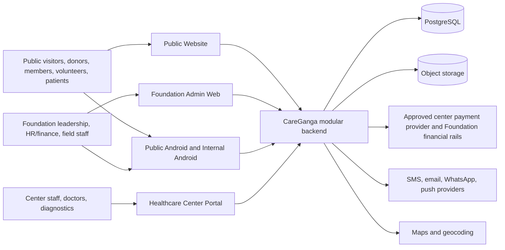
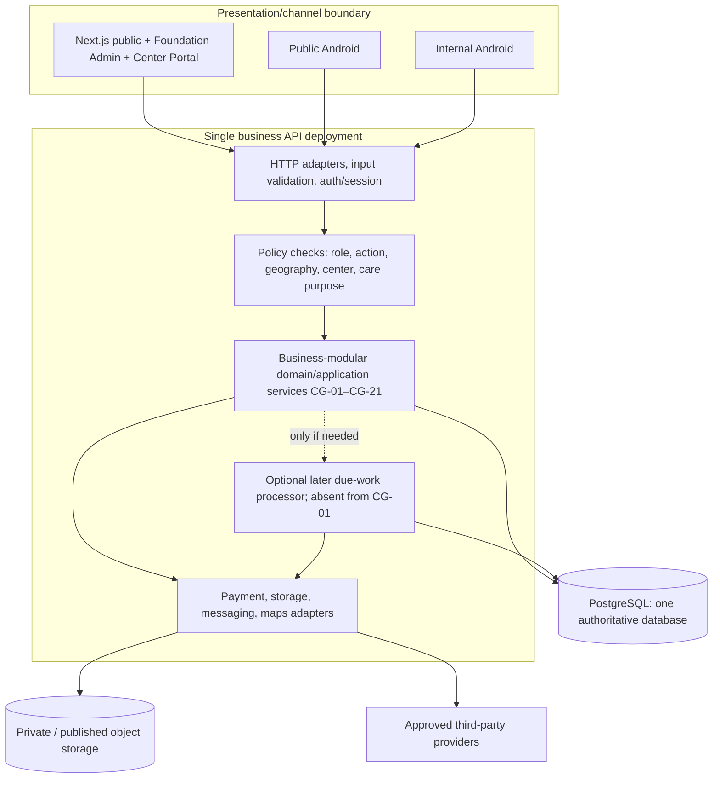
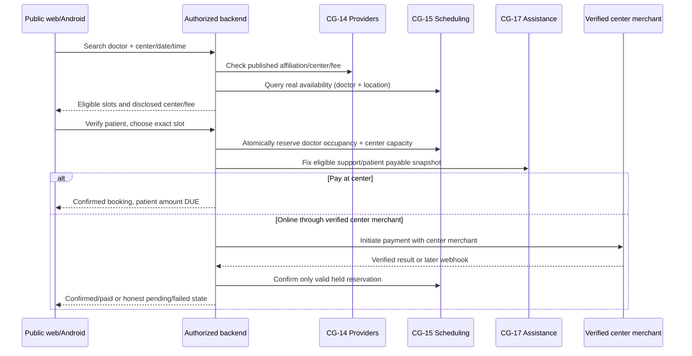

# CareGanga Foundation — Integrated Platform High-Level Design (HLD)

**Document version:** 1.1 — DRAFT / REVIEW_REQUIRED; preceding owner-delegated approved baseline is preserved as version 1.0 by its prior Git commit and SHA-256 in `approvals.json`. This current file replaces the working draft **at the same canonical path**; no v2 folder or parallel document. Changes after renewed approval require another explicit version increment and review.  
**Initiative:** `careganga-foundation-platform`  
**Product / repository:** CareGanga Foundation · `jasiqlabs/careganga`  
**Mode:** GREENFIELD — no running product, deployed infrastructure, selected runtime stack or existing implementation assumed  
**Authoritative location:** `specs/initiatives/careganga-foundation-platform/hld.md`  
**Working branch:** `feature/careganga-greenfield-prd-20261114`  
**Architecture baseline:** Current product PRD `prd.md` (including mandatory N-13 visual/motion fidelity) and source BR/NFR documents in `docs/business-requirements/`; final PRD approval hash requires revalidation after the current changes.  
**Harness stage policy:** The latest reviewed `jasiq-harness/main` is `ec7c0b81fb2e1e7845ea1b0a46df1114022cd0b1` (15 November 2026), including scriptless latest-source authoring rules; the CareGanga bootstrap pin and root AGENTS.md match it. This HLD follows the database, design-pattern, background-work, mobile-store, UI-quality and source-review standards. **Authenticated local Harness checkout/stage resolver and independent specialist review remain NOT_RUN**; the GitHub source comparison and updated pin are not resolver PASS. New CG-01 security-policy ownership and CG-21 exclusion are source design revisions requiring current-hash reapproval.  
**Prepared:** 14 November 2026  
**Status:** **DRAFT / RE-REVIEW REQUIRED** against updated PRD N-13, Harness HLD and original CareGanga screenshot/video references. Earlier delegated HLD approval covered its prior file SHA only. Current hash-bound reapproval, local resolver and rendered visual comparison are NOT_RUN; no QA/release PASS is claimed.  
**Approval integrity:** The owner explicitly authorized agent delegation for design review in this conversation. The current `initiative.json` opts in to narrowly scoped `OWNER_DELEGATED_DESIGN` for PRD/HLD. An approval must be truthfully attributed to the actual delegate as `DELEGATED_APPROVED` with the current file SHA-256, review evidence and validated resolver gate, never falsely as human/client sign-off. No resolver PASS or human/client approval is claimed by this document; any delegated design decision must be separately recorded and hash-checked in initiative-local `approvals.json`. QA/UAT/release/merges require independent owner authorization.

## 1. Executive architecture decision

Build **one business-modular platform with a single authoritative backend and PostgreSQL database**, five client-facing channel experiences, separate confidential/public file treatment and minimal reliable integration workers. Start as a **modular monolith**, not 21 microservices. Keep boundaries explicit so accounting, scheduling, CMS, approval, staff and healthcare records cannot be duplicated by public/mobile interfaces.

**Proposed implementation families, to validate in Planning before dependencies are selected:**

- **Public Website + Foundation Admin + Healthcare Center Portal:** a shared **TypeScript/React/Next.js web codebase**, with distinct route areas, authorization and navigation; server-render/index **only approved public content**. Shared visual system and forms, separate permitted screens per role.
- **Two Android applications:** two distinct **React Native/Expo** distributions — Public Android and Internal Android — sharing domain-neutral design primitives, API contract and localization facilities without merging their identities or app/navigation permissions. iOS is **not contracted** by this PRD; any later iOS build requires explicit scope and App Store compatibility review.
- **Backend:** one **TypeScript/NestJS** application (HTTP/API, domain modules, validation, permission enforcement and integration adapters), independently deployable from web apps. A separated worker *process* from the same codebase may be used when background load justifies it, without a second business backend.
- **Persistence:** one managed **PostgreSQL** primary for transactional records and one appropriately secured object store for private documents and public media. Use built-in relational constraints and transactions; do not add another database for every module.
- **Side effects:** verified payment adapters and a **small durable database-backed outbox/job mechanism** for external notifications, documents and reconciliation. Introduce a dedicated queue/cache only if measured job throughput or latency requires it.
- **Operational posture:** managed hosting, backup, logs, health metrics and provider credentials in environment/secret management. Prefer a small number of runtime services and documented manual operational procedures over container orchestration or a service mesh.

These are **architecture proposals**, not assertions that any code or environment already exists. Exact versions, endpoints, schemas, indexes, library selection and deployment provider belong in module design/implementation.

## 2. Source authority, design drivers and constraints

### 2.1 Authoritative requirements

- [Product PRD](prd.md): FR-001–080, BR-001–017, A-01–A-21, product-wide N-01–N-12, and adopted business defaults D-01–D-25.
- [Master BR](../../../docs/business-requirements/00-MASTER-BUSINESS-REQUIREMENTS.md), [Foundation BR](../../../docs/business-requirements/01-FOUNDATION-OPERATIONS-BR.md), [Integrated Healthcare BR](../../../docs/business-requirements/02-INTEGRATED-HEALTHCARE-BR.md), [CMS/Channel BR](../../../docs/business-requirements/03-CMS-CHANNELS-BR.md), [Source Coverage Audit](../../../docs/business-requirements/05-SOURCE-TO-BR-COVERAGE-AUDIT.md), [NFR Baseline](../../../docs/business-requirements/06-NON-FUNCTIONAL-BUSINESS-REQUIREMENTS.md) and [Decision Register](../../../docs/business-requirements/04-TRACEABILITY-DECISIONS.md).
- Admin screenshot audit [reference](../../../docs/research/CAREGANGA-ADMIN-PANEL-SCREENSHOT-UIUX-AUDIT.md); UI reference records are design evidence, **not a working-code or production-data audit**.

The PRD's delegated business defaults govern the **provisional architecture scope**. Client sign-off, financial/provider credentials, statutory facts, regulated handling and release terms remain separate operational prerequisites.

### 2.2 Critical architecture drivers

| Driver | Source | Required architectural answer |
| --- | --- | --- |
| Five distinct user interfaces, one current state | FR-077–080, BR-001–002 | Reused backend contracts, shared validation, web channel areas and two distinct Android apps |
| One protected Foundation with geography + centers | FR-001–008, 042–046, N-01 | Central identity/roles, entity grants, organization/area/branch/center constraints and purpose-based health access |
| Common approval and final-authority model | FR-005–008, BR-003 | Shared approval decision workflow with owner-domain finalization |
| One financial authority and no duplicate money | FR-017–028, 034–036, 059–065, N-02 | Balanced accounting posting, linked source events, idempotent payment/settlement ledger handling |
| Doctor practices in multiple centers | FR-044, 047–053, BR-009–010, N-03 | One provider/doctor source, doctor-wide in-person occupancy plus center-specific offerings/capacity |
| Healthcare payment and subsidy are separate | FR-060–065, D-03–04, BR-008 | Center-collected patient payments distinct from Foundation liabilities/settlements |
| Patient/medical confidentiality | FR-049, 054–057, N-01/05 | Care-relationship authorization, private clinical documents, safe QR verification, access auditing |
| CMS controls public visibility, not owner data | FR-066–069, BR-005/012 | Publication gate and public safe projection from owner modules |
| Async provider errors must not corrupt core work | FR-018–019, 051, 070–072, N-04 | Transactional state and durable retry of external side effects |
| Performance/low operating complexity | N-06–11 and CG-BR-600 | Small deployment, bounded query/worker load, indexable public SSR, metrics and restore plan |

### 2.3 Assumptions and exclusions

- **One Foundation operating organization** with many Foundation branches and independently scoped **healthcare provider centers**. There is no agreed multi-customer SaaS tenancy model; do not add subscription/tenant billing infrastructure.
- A Foundation branch is **not** equivalent to a healthcare center. One healthcare center may have operating locations; doctor affiliations across centers do not clone the doctor.
- Real user counts, doctor/center inventory, daily bookings, peaks, hosting budget, languages beyond initial English, availability SLA, RPO/RTO and legal data retention remain **unconfirmed**. Apply P0 correctness/security regardless, treat numeric P1 targets as sizing proposals.
- Launch public transaction support is **doctor consultation booking only**. Lab service information is public; **internal** center test orders, sample processing and authorized reports are in scope. No e-pharmacy checkout, insurance claims processor, nursing/OT theater engine, structured EMR, family booking engine, separate clinical ticketing engine beyond the approved CG-19 support/helpdesk or full offline synchronization is invented.
- Existing mockup doctor names, center names, ratings, fees, verification badges, UPI IDs, addresses, receipts and proportions are **sample data**, never production defaults.
- **No CI/GitHub Actions** in this project. During Development, use **manual code review only**, including scenario-by-scenario QA source tracing across applicable backend, responsive Web and Android paths; **do not execute apps, tests, builds, emulators, browser previews or screenshots**. Runtime and rendered-UI evidence belongs only to separately authorized independent QA/Release and must remain `NOT_RUN`/`VISUAL_NOT_RUN` until actually performed.

## 3. Context, actors and trust zones

### 3.1 High-level system context



**Trust boundary 1 — Internet/public:** Published marketing, service search, application and payment initiation can be available without staff authorization, with explicit response allowlists, user identity verification where appropriate, throttling and no private record enumeration.

**Trust boundary 2 — Authenticated personal:** Member/volunteer/employee/patient self-service grants **only that subject's** confirmed relationship and records; an association with a person record is not automatically clinical permission.

**Trust boundary 3 — Foundation operations:** Protected roles + action + organization/geographic/branch/assigned resource; a public role does not become staff by logging into another channel.

**Trust boundary 4 — Healthcare operations:** Center/operating-location context + professional/role scope + permitted treatment purpose. A center user cannot browse another center's patient data, bank details, internal cases or settlement records.

**Trust boundary 5 — Infrastructure/providers:** Database, private object files, payment webhooks and internal workers are server-only. External provider messages must be authenticated and treated as **untrusted until verified**.

## 4. Proposed runtime/container view



**Logical channels vs deployables:** The three web experiences can share one frontend project while using independently protected routes/layouts. Two Android **app packages** remain independently releasable. Backend module boundaries are **internal**, not microservice deployments. Private medical and employment documents do not become public CDN assets merely because they are in the same object storage account.

### 4.0 Canonical repo/workspace layout and bootstrapping boundary

**Single repository and modular monolith:** Bootstrap once inside CG-01/US-001, then add delivered business modules within the *same* backend application. The fixed top-level shape is:

```text
careganga/
  apps/
    backend/          # single NestJS backend; business-owned CG modules
    web/              # one Next.js web app: public / admin / center route areas
    android-public/   # separate Expo Android package and secure session boundary
    android-internal/ # separate Expo Android package and secure session boundary
  packages/
    api-contracts/    # minimal safe transport DTO schemas, no domain truth
    design-tokens/    # single approved CareGanga visual and motion source
  docs/               # existing business requests / screenshot audit
  specs/              # existing PRD/HLD/module plans/approvals
  scripts/            # existing Harness resolver and small utilities
```

**Module extension principle:** The single backend composition root registers **only implemented** CG business modules. Every future owner adds a sibling backend module, its own persistence/migrations in the same PostgreSQL history, and applicable UI features inside the existing apps. Modules communicate through stable, typed, access-checked owner facades, **not by importing one another's tables/repositories**, circular dependencies or another server. Reuse existing auth, sanctioned errors, observability and UI tokens; do not duplicate a framework for each module. CG-01 has **no required CG-02–CG-21 imports, database references, provider configuration, workers or dummy records**.

**Minimal first runnable baseline:** US-001 owns the one-off workspace/package/lockfile, backend entry + validated configuration, DB migration runner, health/readiness and sanitized error/logging, initial CG-01 authentication/session, one shared web shell with distinct protected areas, two independent native app identities, shared safe API contracts and reference-derived visual tokens. Nothing else is generated until its real owner module is implemented. Startup must not require optional future financial/healthcare providers; absent required auth/MFA configuration fails closed without hardcoded codes. Conditional workers appear only with real approved due work, never at idle. Pin and verify compatible native dependencies before mobile implementation. Exact folder/file/command blueprint and QA gate live in CG-01 DLD §1A and US-001; this HLD describes the **architecture boundary**, not a per-file implementation spec.

### 4.1 Interface responsibilities

| Interface | Owns | Does not own |
| --- | --- | --- |
| Public website | SEO-friendly content presentation, published directory, public registration/donation/doctor booking and verified self-service | Business approval, fee eligibility, real appointment inventory, payment verification |
| Foundation Admin web | Authorized operational/configuration screens, policy, approval and CMS control, network-wide reports | Independent ledger or shadow domain masters |
| Center Portal | Scoped own-center provider management, doctor scheduling, patient reception, internal lab work and center collections | Foundation-wide clinical records, central settlement authority, unverified publication |
| Public Android | Public and self-service flows, verified patient and member/donor interactions | Foundation/Admin role shortcuts |
| Internal Android | Field GPS/photo evidence, attendance/leave/claims/requests and assigned approvals | An unconstrained replica of entire Admin or unverified offline writes |
| Backend | Domain ownership, authorization, validation, state/transaction consistency, side-effect coordination | HTML-only business validation or fixed sample UI data |

**Mandatory existing-CareGanga visual and motion architecture (PRD N-13):** The original `careganga_features_screenshot.zip`, together with [CG-REF-ADMIN-001 (167-image audit)](../../../docs/research/CAREGANGA-ADMIN-PANEL-SCREENSHOT-UIUX-AUDIT.md), is the **product appearance and interaction authority**, not merely inspiration. All affected module Web/Android/public/center screens preserve the **same CareGanga brand colors, typography hierarchy, spacing, iconography, borders/radii/shadows, sidebar/header, cards, tables, forms, right-side drawers, badges, status styling and evidence-supported motion/transition/feedback behaviors**. The Admin shell follows the observed hierarchy; native Android/public/center channels adapt navigation/layout to task and accessibility without changing core visual identity. No per-module replacement themes, mismatched fonts/icons, arbitrary animation or cosmetic redesign.

**One shared implementation seam:** During first frontend bootstrap, inspect original image/video assets and establish **one versioned, reusable theme/component/motion token implementation in product code**, consumed by each applicable Web area and translated to corresponding tokens/components in both native Android packages; no 21 separate CSS palettes or duplicate design-system projects. Token groups cover verified palette/semantic states, typography, spacing, radii/shadow, icons, control/drawer/menu/modal/tab variants, focus/feedback and motion duration/easing. **Do not invent specific HEX, font or animation constants from the text audit**; capture exact values from original reference assets and update only through reviewed product design decisions. A still screenshot cannot substantiate animation timing: validate the original recorded interaction/video or other approved motion source. Preserve accessible reduced-motion behavior, readable contrast, responsive/native affordances and genuine loading/pending/error states; this is an allowed functional adaptation, not a redesign.

**Every UI-bearing business module must apply this invariant:** In `module.md` cite applicable screenshot IDs + current token/component reuse; choose `uiux_decision: REQUIRED` for materially new journeys, `EXISTING` with a real approved product reference for reuse, or justify `NOT_REQUIRED` when no UI is affected. Its single `tasks.md` includes relevant cross-channel visual/motion, interaction and accessibility acceptance and source-review QA. Conditional UIUX/DLD works **inside Harness Planning** rather than creating more gates; each module consumes the same code implementation and approved HLD/PRD N-13. Manual development review can establish source consistency only (`VISUAL_NOT_RUN`); **exact color/motion/pixel fidelity requires separate authorized rendered comparison to original PNG/video assets**. When source assets are inaccessible, mark `REFERENCE_ASSETS_NOT_VERIFIED`, not visual PASS. Human-friendly labels, protected scopes and safe error messages still follow §4.3.


### 4.1A Admin-audit-to-Web/Android contract (CG-REF-ADMIN-001)

The 167-image [Admin Panel screenshot audit](../../../docs/research/CAREGANGA-ADMIN-PANEL-SCREENSHOT-UIUX-AUDIT.md) **§2.1, §8.1, §8.2, §12.3** is the existing-desktop-Admin reference. It describes visible controls, not proven functional APIs, motion timing or Android screenshots. The initial bootstrap MUST establish one source-derived semantic color/type/spacing/radius/icon/status/motion token model at `packages/design-tokens`, one reusable accessible Web component vocabulary at `apps/web/src/shared`, and native React Native adaptations within each Android app. The shared source is **design tokens and safe transport contracts**, not a copied desktop DOM or a merged login session.

| Surface | Original audit evidence and required layout | What bootstrap/first module must do; later owner boundary |
| --- | --- | --- |
| **Foundation Admin Web** | Audit §2.1: long searchable categorized sidebar with blue active marker and Super Admin identity footer; title/subtitle, header global search (Ctrl+K hint), notifications/inbox, View Site, help, avatar; KPI row, filter/search toolbar, tabbed tables, right detail drawers | Build the same recognizable shell and compact content hierarchy. U02 (Users), U03–04 (Add Staff drawer), U05–07 (Roles/matrix), U08–09 (Role drawer/copy), U10 (Area Level) and B34 (Role Assignment) are CG-01's reference screens. Preserve observed relative hierarchy and status/card/drawer idiom; show *only actually implemented* records/controls. Global search must not pretend future projects, donations or patients exist; header/sidebar search scopes are distinct and permission-filtered. Inbox/notifications remain truthful until CG-19. |
| **Responsive Admin Web** | Same desktop reference controls; audit §8.2 documents overload and overflow risks, not an alternative identity | On tablet collapse optional secondary panels; on narrow screens preserve task/order and labels using menu drawer, capped filter groups, record detail rows and full-width edit sheets. Never horizontally crush sensitive tables or replace the approved aesthetic with unrelated cards. |
| **Internal Android** | No Android capture in the 167-image Admin audit (audit §12.3); visual semantics from U02–U10/B34 are the transferable authority | Native staff tasks: sign-in/MFA, Accounts→Search→Details→Assign Role and Roles→List→Create/Edit/Copy→Permissions→Confirm. Use same semantic brand/status/icons and form vocabulary; touch targets, Back/keyboard/insets and native navigation are intentional adaptations, not a fictitious pixel-perfect Android screenshot. Never embed the Admin Web UI inside a WebView. |
| **Public Website + Public Android** | Admin capture shows only View Site/publication entry, **not** complete consumer screens | Carry original CareGanga branding and status semantics without an Admin sidebar, Super Admin menu, HR directory or privileged role editor. Public content and self-service appear only as their real owner modules arrive; missing future integrations must have truthful states. |
| **Healthcare Center Portal** | Admin screenshot shell is brand reference, not proof of center operating UI or permission | Distinct scoped center navigation and privacy; never copy Foundation Admin access, role editor, medical data or unpublished settings into the center client. CG-14/15/16 provide real center workflows later. |

**Observed shared component anatomy:** `AdminShell` (brand/sidebar/menu search, page title, header controls), `PageHeader`, `SummaryMetric`, `SearchFilterToolbar`, `StatusTabs`, `RecordsTable` with responsive row/detail projection, `RightSideFormDrawer`, `ConfirmationDialog`, `StatusBadge`, `PermissionMatrix`, and a controlled `HumanOutcomeNotice`. These are roles/components, not an instruction to manufacture a class for each screenshot. Components use one token source, real API data and safe messages; a screen cannot show invented KPI counts, disabled future menu items as working links or sample patient/staff records.

**First bootstrap's visual evidence contract:** inspect actual archived PNG/video assets before freezing exact HEX/fonts/radii/easing. Still images support visible placement and static appearance, **not** animation duration/easing nor native-layout parity. Record the asset ID/verified token extraction in the existing CG-01 `uiux.md` and source task evidence. A desktop and responsive Web screen should be compared to U02/U05/U08/B34; Android must separately be reviewed for consistent tokens and usable task-first flow. Until original asset and rendered/device checks exist, state `REFERENCE_IMAGES_NOT_AVAILABLE`, `VISUAL_NOT_RUN` / `MOTION_NOT_VERIFIED`, not PASS. WCAG 2.2 AA/reduced motion, security and corrected responsive usability may modify layout **without changing the original brand**.


### 4.2 API and contract strategy

Use a coherent versioned **HTTP JSON API** with shared typed contracts, centrally enforced authentication, validation, pagination/filtering and consistent explicit error semantics. Public published queries are separate from authenticated private queries. Each channel calls the same domain application operations; authorization is re-evaluated on every protected request, not trusted to mobile navigation or page-level controls.

Only architecture-level contract classes are fixed here: **public-anonymous, public-authenticated, Foundation-private, center-private, privileged-operations, signed-provider-webhook/internal job**. Exact URLs, DTOs, table structure and token format belong to DLD.

### 4.3 Human-friendly results and secure exception boundary (P0)

**One backend outcome model and one UI language policy across every channel:** Business modules return explicit **validated success, submitted/pending, field correction, authorization/record-visibility denial, conflict/duplicate, unavailable/dependency failure, unknown/pending reconciliation, or unexpected failure** outcomes. A small common backend exception mapper catches *unhandled* exceptions at the API boundary; it emits a safe, stable external result with appropriate transport semantics while writing a **restricted diagnostic event**. Expected domain outcomes are translated deliberately; blanket catch-and-return-success or raw exception forwarding is forbidden.

- **Public/client response:** A short, non-sensitive message category, user-relevant field labels/correction guidance, safe next action and optional opaque support reference. Do not expose stack traces, source paths, SQL and constraint details, HTTP status numbers as copy, internal permission identifiers, gateway error payloads, database IDs or exception strings. Programmatic client codes may exist for safe behavior routing, but the frontend renders a **controlled business-language message**, never a raw code or arbitrary provider text. Backend JSON, server-rendered failures, PDFs, notifications and QR lookup follow the same confidentiality rule.
- **Successful and nonfinal outcomes:** A completed change has specific positive acknowledgement (e.g. booking confirmed, application submitted); queued reviews, uploading, online-payment verification or late callbacks remain explicitly **pending**, not falsely completed. Distinguish truly empty search results from failed search, logged-out sessions from forbidden access, and unavailable time slots from generic server failure. For an **unknown write result**, guide the user to check the existing record before trying again; idempotency/reconciliation prevent duplicate operations.
- **Validation:** Domain validation identifies the actual human field (e.g. Mobile number, Appointment time, Payment method), not `patientId`, `doctorUuid`, `plantId`, a JSON key or database constraint. Frontend can validate interactively, but the backend remains authoritative. Protect private record existence on denied/lookup failures.
- **Presentation and reference rule:** UI controls select linked records using **names, searchable approved descriptions and useful contextual disambiguation**, while request payloads may carry stable internal IDs invisibly. Automatically generate legitimate business references at the owner module (membership number, employee ID, patient ID, appointment/invoice/receipt number); show them only where they help the user's real workflow, with a human label. Safe prefilled user/center/branch/date context avoids unnecessary mandatory code fields; never silently pre-consent, approve, authorize eligibility or initiate money movement.
- **Technical side:** Attach a safe trace/correlation token across web/Android API request, backend domain action, database transaction result, async outbox and external provider attempt. Restrict diagnostic details and stack traces to appropriate operator access; redact sensitive personal, financial, medical, OTP/token and request/response contents. Optionally show an easy-to-share **Support reference** on unexpected errors—never require the user to supply a UUID for an ordinary workflow.

**Relevant standards:** CG-NFR-UI09–12, CG-NFR-MSG01–06, CG-NFR-LOG01–06; FR-080, BR-017 and product N-09/N-11/N-12. Module Planning/DLD must specify the minimal standard outcomes for affected journeys and manual QA; implementation reuses a small mapper/message catalog, **not** a new independent error-handling microservice or general rule engine.

## 5. Business boundaries and conceptual data ownership

A **business owner module owns its lifecycle, data invariants and write operations**. Other modules consume typed application facades/commands/queries, reference IDs, or validated domain events, **never write through another module's repository or tables**. Modules may be grouped by business area for code organization without changing 21 CG owner IDs.

| Owner | High-level responsibility and authoritative records | Primary consumers |
| --- | --- | --- |
| **CG-01 Identity & Access** | Identity, credentials, **Foundation-root password/session/MFA policy and enforcement**, protected security-policy changes, access sessions, roles, action grants, area/branch/center grants and original access audit | All protected modules, including CG-21 privileged recovery |
| **CG-02 Foundation Structure** | Foundation profile, internal branches, geography, departments, committees | Staff, projects, budgets, admin reporting |
| **CG-03 Applications & Approval** | Application case, steps/decisions, verification and finalization references | Registration, finance, CSR, providers, payroll |
| **CG-04 Members & Volunteers** | Participant relationship, membership plan/term/fee entitlement, volunteer affiliation | Public self-service, programs, referrals |
| **CG-05 Projects & Field Work** | Project, event/activity, tasks, field visit/GPS evidence metadata | Beneficiary help, budgets, impact |
| **CG-06 Beneficiaries & Aid** | Private beneficiary relationship, aid events, distribution details | Projects, inventory, reports |
| **CG-07 Fundraising & Donations** | Campaign/donor donation intent, verified transaction status and receipt source | Finance, CMS, donor portal |
| **CG-08 CSR & Funding** | CSR partner, proposal, commitment, funding split and allocation intent | Project/finance/budgets |
| **CG-09 Finance & Budgets** | Chart of accounts, posted entries, bank/cash ownership, voucher/invoice, fund/project allocations | All monetary owners and financial MIS |
| **CG-10 HR & Employees** | Employee relationship, attendance, leave, lifecycle/letters | Internal app, payroll, approval |
| **CG-11 Payroll** | Salary policy, period calculation/run, payment batch/payslip source | HR, finance, documents |
| **CG-12 Inventory & Vendors** | Items, vendors, stock receipt/issue/adjustment, material request/fulfillment | Beneficiaries, projects, rewards |
| **CG-13 Referrals & Rewards** | Attribution, points ledger, ranks, redemption and reward entitlement | Members, inventory, reporting |
| **CG-14 Healthcare Network** | Provider/center/branch, doctors, professional verification, affiliation, center-specific price/services | Directory, scheduling, CMS |
| **CG-15 Patients & Appointments** | Patient ID/identity and consent references, doctor availability/holds/booking/queue | Public/center, billing, reports |
| **CG-16 Diagnostics** | Tests/packages, internal lab order/sample/report release | Center portal, patient report access, billing |
| **CG-17 Healthcare Assistance & Settlement** | Benefit policy/version, patient charges and center-collected status, Foundation liability, settlement/adjustment | Booking, finance, provider reports |
| **CG-18 CMS & Publication** | Editorial sections, public presentations, publish visibility/revision | Public site and app |
| **CG-19 Docs, Communication & Support** | Private/validated uploaded media/file bytes, versioned source-derived PDFs/letters, original notices/recipient delivery/outbox, one Foundation public contact/support case/FAQ and protected history. Initial file/document/event sources CG-01/03, with genuine later owner integrations | CG-01/03 first; CG-21 provider refs optional; CG-18 only public contact/notice presentation, CG-14 later center-specific ticket scope |
| **CG-20 MIS & Analytics** | Scoped reports, saved views, aggregate/statistical projections, scheduled reports | Admin, center, authorized staff |
| **CG-21 Platform & Audit** | **Nonsecret versioned operational settings**, external provider credential-reference and readiness metadata, **read-only bounded central view of owner-held audit**, CG-21's own platform audit, and guarded recovery availability/requests | Existing CG-01 auth/audit first; later business owners integrate their real source events, CG-18 owns public visibility |

### 5.1 People and confidentiality model

An **identity account** can associate with several person/business relationships (member, volunteer, employee, beneficiary, patient or doctor) only after appropriate verification; association is **not permission inheritance**. Clinical patient records and staff bank/payroll information have purpose-specific controls. A doctor can have one verified professional profile and many approved affiliations; appointments reference **one actual center location**.

Where the same contact number appears in multiple contexts, avoid auto-merging protected records. Record consent and explicit verification for sensitive associations; audit authorized access to sensitive reports and private documents. Public searches show only publication-approved fields.

### 5.2 Foundation branch vs healthcare center

Foundation organization geography and internal branch hierarchies come from CG-02; provider businesses, their locations and operational scopes come from CG-14. A geographic link may support reporting but **does not share staff/financial/clinical visibility automatically**. CG-01 policy validates the actual actor's assignment across these distinct boundaries.

**Cross-owner rule for configuration UI:** CG-01 owns all mutable password/session/MFA security policy and real enforcement; CG-02 owns legal Foundation identity; CG-18 owns public Login/Member Join/Volunteer Join visibility and editorial publication, including presentation of a **CG-19-owned** public contact form/approved safe notice; CG-19 owns **all** contact/support records, original operational notice, private file bytes and actual transmission/delivery; CG-14 later owns only the true center account/scope integration into CG-19 support; CG-09/17 own actual financial effects. The Admin Settings visual shell can link to each genuine source screen but CG-21 must not store or implement another owner's requirements. Only the introducing later owner builds and tests its own public/client/audit integration, never a required CG-21 startup dependency.

### 5.3 Cross-module dependency rules

- CG-03 can record verification/approval, but **only the owning module applies the final business transition** after validating current state.
- CG-09 is the **Foundation accounting system of record** for recognized Foundation money; domain modules carry references to its accepted entries. CG-17 owns separate center collection/benefit source records. A center merchant's patient receipt must **not be automatically posted as Foundation cash**.
- CG-19 generates from authorized source data, not independently edited totals; a PDF/reference/QR is a *projection*, not the source booking or payment.
- CG-18 publishes a safe **field allowlist/projection** of approved provider/doctor/project data; editors cannot mutate clinical registration, schedules, member activation or billing through a published page.
- CG-20 reads authorized domain contracts or restricted read models; a report writer/export/scheduled job must not bypass actor scope or replicate conflicting ledger totals.
- Each owning module writes its durable, redacted business audit alongside the protected transition (CG-01 keeps original access-audit authority). CG-21 exposes a permissioned central audit view/configuration over those genuine owner events; it must not become a second audit ledger or silently turn a failed transaction into user-visible success.


**Canonical contract review:** An owner DLD must define one unambiguous table/record/command contract, not competing alias schemas; privacy and scope are checked on options, full reads, exports, files and mutations. A cross-owner finalization commits **at most one effect** for the immutable *submitted source revision and decision identity*; an old decision cannot authorize newly edited source content. CG-02 owns one branch registration and one approved branch record; CG-03 owns the pinned process/case/decision and returns a trustworthy final decision only for the matching revision; CG-09 enforces balanced posting per immutable financial event; CG-15 owns one doctor-wide time occupancy authority independent of center. Concrete migrations and DTOs stay in their owning DLDs. CG-01 completes root-context accounts and ordinary role management without an approval request. CG-03 later introduces a genuine protected-access-change case for existing verified CG-01 account/role targets and calls CG-01's guarded single-application finalizer only after final review.

### Delivery dependency order — independently useful modules (mandatory Planning gate)

**Implementation navigation:** The [single canonical 21-module development order](DEVELOPMENT_ORDER.md) defines one **foundation-first delivery gate followed by up to three truly independent developer workstreams**, with real owner prerequisites, exact ready waves and complete-story exit conditions. It is an execution guide derived from this HLD, not a second PRD/task tracker or substitute for current hash-bound approval and Harness resolver. Every module plan links back to it; keep that same file updated if dependency order changes after review.

The following is a **logical prerequisite order, not one mandatory sequential release train**. Independently ready modules may progress in parallel. A one-time technical bootstrap plus CG-01 establish real shared primitives; each later module's own acceptance must use **real completed** contracts, not records belonging to future modules.

| Dependency band | Business modules and delivery boundary |
| --- | --- |
| Bootstrap / core | Technical bootstrap → **CG-01** real Foundation-root accounts, role editor, grants and session enforcement |
| Shared foundation | **CG-21** real settings/audit → **CG-03** real scoped approval cases over actual CG-01 account/role targets and guarded grant finalization → **CG-19** real protected files, templates and configured delivery |
| Organization/finance | **CG-02** real branches/geography/department after approval; **CG-09** balanced Foundation accounting, budgets and payments |
| Public and business owners | **CG-18** editorial/public CMS core; **CG-14** real provider/doctor directory; **CG-10** employees; **CG-04** memberships/volunteers; **CG-05** projects; **CG-12** inventory. Order by their actual prerequisite source data |
| Transaction consumers | **CG-07** verified donations; **CG-08** CSR; **CG-06** beneficiary aid; **CG-11** payroll; **CG-13** points/rewards |
| Healthcare workflows | **CG-15** patient/schedule/booking with verified CG-14 inventory, **CG-16** internal diagnostics and controlled reports, **CG-17** support policy, verified center collection and Foundation settlement |
| Cross-domain reads | **CG-20** final integrated dashboards, custom/scheduled reports and exports using only real owner projections |

**Actual shared foundation vs safe concurrency:** The default conservative foundation is **CG-01 bootstrap/auth → CG-21 platform operations → CG-03 approvals → CG-19 protected files → CG-02 real Foundation organization/branches**. CG-21 is intentionally scheduled early to stabilize common config/diagnostics, **not** a false data prerequisite of CG-03. Only after these are delivered and integrated may **P1: CG-09 accounting ∥ CG-14 healthcare network ∥ CG-10 HR** be independently developed. After their real predecessors are available, P2–P5 group further nonoverlapping business owners; CG-20 is the final integrated reporting step. With two developers, choose two dependency-ready modules from the canonical waves instead of treating unfinished peer modules as real. Separate module folders, isolated development DBs/provider config, noncolliding owned migrations, shared-file integrator, serial integration and independent QA gates are mandatory. The precise 2–3 developer wave schedule and integration handoff are in [DEVELOPMENT_ORDER.md](DEVELOPMENT_ORDER.md), **not** another HLD-level backlog. Formal source QA is distinct from independently authorized live QA; do not mark missing runtime evidence PASS.

**Forward-owner integration rule:** CG-02 owns the real Foundation profile and geography, the seven-stage branch source, optional CG-01 account heads/committee participants and the first working protected branch-registration/approval/files integration. **CG-02 US-001 owns only the Foundation-wide department/committee and identity/geography flow, independently finished/tested with real CG-01 and zero branches or CG-03/19 data. CG-02 US-002 owns the separate branch registration/activation, current branch operating profile and append-only original-approved-source-preserving revision history, plus branch-scoped department and Foundation-to-branch links, once real CG-03/19 contracts exist.** A Foundation-wide department or committee must be usable before any branch exists; a branch-scoped one requires a real active branch. CG-02 introduces real area/branch scope selectors and corresponding authorization integration into existing CG-01 without requiring CG-01 to have known future branches at bootstrap. CG-10/04/05/09 later own true employee/member/project/budget relationships and implement their CG-02 associations; CG-02 never seeds their records or blocks a new branch pending their delivery.

**Forward-owner integration rule (other modules):** CG-18 may deliver genuine editorial pages and neutral healthcare categories before CG-14/17 exist, but it must **not** publish fabricated providers, fees, support percentages or stats. CG-14 delivers actual public provider directory bindings; CG-17 delivers approved support/price projection into existing CMS/booking; CG-15's own booking must remain functional with true full-fee/due state before CG-17 payment support and cannot claim settled payment. CG-10 supplies employee filters/links and CG-02 supplies area/branch selectors to CG-01; CG-14 supplies actual center affiliation. The later introducing owner must trace the cross-module UI/API/DB/privacy cases and cannot mark them satisfied from placeholder contracts. The PRD requirements stay in scope, never silently deleted or duplicated as shadow masters.

Every module's `module.md` must explain its genuinely available dependencies; `tasks.md` must use exact within-module story dependencies (not artificial US-ID ordering). A task requiring an unfinished later owner is rejected or the prerequisite is moved before it. No release sign-off without later cross-module integration QA.

### 5.4 Scenario-driven architecture-pattern selection (latest Harness gate)

Patterns are chosen to protect **real variation or invariants**, not to maximize classes. Per `standards/ENGINEERING_STANDARD.md`, these are architectural seams; exact interfaces, constraints and errors belong to a REQUIRED module DLD.

| Scenario / owner | Minimal chosen seam and invariant | Alternatives, including doing nothing | Extensibility / measurable trade-off |
| --- | --- | --- | --- |
| Membership, branch, provider, finance and payroll approval routes — CG-03 | **Composed orchestrator plus guarded state transitions**, with source-domain finalization. One authorized final outcome; correct reviewer scope | Copy process logic independently (simple initially, duplicate approvals); **Template Method** base inheritance (incompatible step ordering/transaction boundaries) | New approved route is validated process configuration plus owner finalizer, not a second approval system; audit every transition and monitor configuration count |
| Fixed/percentage/capped/exceptional healthcare support — CG-17 | Pure versioned **policy/Specification object**; **Strategy** only for genuinely distinct approved calculation algorithms. Accepted fee snapshots never silently change | Hardcode per-portal conditions (simple but divergent); unrestricted rule engine (unnecessary finance and security risk) | Add allow-listed policy variant without changing old bookings; verify 50/50 and approved full-support cases, calculation latency and authorization |
| Doctor booking holds, approval/financial lifecycle — CG-15/03/17 | Explicit **state machine** via guard/transition functions inside cohesive services, plus DB transactions. Prevent invalid transitions and cross-center doctor overlap | Independent status flags (cheap but inconsistent); state class for each status (unnecessary class explosion) | New approved state requires guarded transition/negative tests, not a second scheduler; measure conflicts and rollback |
| Center-specific and Foundation payment/messaging providers — CG-07/17/19/21 | **Adapter** at provider boundary, optionally small typed allow-listed **factory/registry** only when multiple real providers exist. Domain state independent of SDK | Direct provider SDK calls in business logic (fast start, unsafe coupling); generic dynamic plugin framework (unneeded) | Add approved provider through adapter, unchanged financial contract; measure retry/timeout and provider-specific failures |
| Approval + finance + stock + rewards business effects — CG-03/09/12/13 | Scoped **facades** and existing PostgreSQL transaction as **Unit of Work** for same-DB writes. One authoritative stock/ledger/points effect | Direct cross-owner repository writes (initially easy but violates ownership); universal transaction/saga framework (overengineered) | New consumer calls typed facade; keep short locks, idempotency, audit and scope tests |
| Receipt/document/notice/report and settlement side effects — CG-19/17/20 | **Domain event reference + transactional outbox** only when after-commit delivery must survive failure; ordinary UI view updates can be simple functions | Synchronous network calls in DB transaction (long locks); fire-and-forget callbacks (lost work); Kafka (premature) | Bounded idempotent worker, measure zero-job idle queries, retries, provider bytes, dead work |
| Publish approved projects/doctors/centers — CG-18/05/14 | **Publication read projection + source owner facade**, explicit published-field allowlist. A CMS editor cannot change professional/financial truth | Editable duplicate CMS master (drift); separate search service/event-store without proven volume (operational cost) | Add approved public field via owner contract, no draft/medical leak; measure freshness |
| Role/geographic/center/clinical-purpose access — CG-01/02/14/15/16 | **Server-side Specification/Policy objects** for reusable authorization predicates, with scoped database queries and relational ownership checks. No permission inheritance from a linked identity | Inline per-controller conditions (initially simple, inconsistent); unrestricted runtime policy DSL (hard to audit/secure) | Add one approved scope rule without rewriting every UI/API; negative tests for direct record lookup, joins, exports, foreign selectors and signed files; watch query cost |
| Sensitive report composition — CG-20/09/15/17 | **Typed reporting facades and permission-filtered read projections**; routine views remain direct bounded owner queries. Finance and clinical truth stay with owners | One global SQL/report playground (initially flexible, leaks private data); full CQRS warehouse/search cluster (premature cost) | Add an approved report field only through owner contract, preserve recipient scope on scheduled exports, measure rows/bytes and query plans |
| Public-facing outcome and secure failure handling — all modules/channels | **Thin boundary Adapter/mapper** for expected domain outcomes and unexpected exceptions; **controlled message catalog** for human wording, safe reference display and permitted next action. Correlation metadata stays in protected diagnostics | Render backend `error.message` everywhere (leaks internals); custom framework per module (inconsistent, costly) | Add approved domain case once, retain meaningful technical cause in secured logs, test no raw IDs/exceptions in five channels and generated documents |
| Routine profile/catalog/department CRUD — CG-02/10/14 | **Simple application service with scoped queries**; deliberate *no new pattern* decision | Generic repository framework (hides locks/queries); Strategy+Factory+Template Method stack (excessive abstraction) | New normal field should not require new handler classes; preserve clear validation and tests |

**Explicit negative decisions:** No mandatory inheritance-based Template Method; no speculative Abstract Factory, Saga/Process Manager, full CQRS/event-sourcing, distributed transactions, business-rule scripting or microservice-per-module. Add a pattern only if another *approved* variant actually warrants it. Evaluate number of abstractions, query/lock cost, cross-channel parity and compatibility before DLD approval.

## 6. Consequential business interactions and transaction boundaries

### 6.1 Registration/approval/activation (FR-001–011, 020, 042–044)

1. The owning module persists a draft and genuine protected document references; submission freezes an **immutable owner content revision** and a source submission key. Returned corrections create a new submitted revision, preserving past review history.
2. **CG-03 initial completed case** is a CG-03-owned immutable proposal to assign an existing non-root CG-01 custom role containing `roles.manage` to an existing eligible CG-01 account; direct assignment remains approval-required by CG-01. CG-03 pins its own proposal revision/digest, **both observed CG-01 account/access and role revisions**, and the actually seeded immutable approval process version with distinct eligible proposer and protected Super Admin final reviewer/fresh MFA checked at decision time. The introducing CG-03 integrator adds the **CG-01-owned guarded role finalizer**; CG-03 never directly writes CG-01 roles/grants and CG-01 bootstrap remains independently complete without CG-03. No CG-02/04/19 evidence, branch or finance data is required in CG-03 initial acceptance. **Later** CG-02 branch cases use real source revisions and genuine CG-19 file evidence; final new-branch decision requires Super Admin (D-05), and a manager may draft/submit but not self-activate.
3. CG-03's final decision is **not itself proof that the source activated**. It requests owner finalization with the matching decision/revision; the source owner rejects forged, revoked, stale, returned, rejected or superseded cases and, where fees are required, validates verified payment rather than initiated checkout.
4. The source owner's short local transaction uses guarded state and an immutable effect key, plus owner audit and uniqueness, to commit **at most one business effect** (branch/code, membership, provider verification, etc.) despite simultaneous callbacks, retries or lost responses. CG-03 reports PENDING_OWNER until verified owner outcome; no distributed transaction or network call inside a database lock.
5. Genuine document/certificate/notification side effects are initiated after the durable decision/effect through the existing CG-19 bounded outbox as needed. Publication is a separate approved CG-18 action; activating an internal branch/provider does not automatically publish it.

**Concurrency/error:** Enforce immutable submitted-revision/decision binding, optimistic draft revision or narrowly scoped row locks, unique source/effect keys and approved business identifiers. A returned/rejected/corrected branch never receives a code; a revoked reviewer or previous-case approval cannot authorize the current draft. Confirm the actual owner state after an unknown write result before repeating a mutation. For CG-02, unimplemented future employee/project/budget/member modules cannot be eligibility prerequisites; real CG-01 manager and CG-19 evidence are required only where the approved registration policy specifies them.

### 6.2 Foundation finance and other source payments (FR-017–028, 034–041)

- **Foundation accounting** posts accepted balanced monetary entries in one controlled transaction. Every external source event has one business correlation/reference and an idempotency guarantee.
- **Donation/campaign/member payment** remains pending until verified provider confirmation; capture linked cash receipt, donor/membership effects and financial posting without double credit or duplicate PDF.
- **CSR** tracks proposal/commitment/receipt/allocation/expense separately. An approved pledge is **not** cash/bank income.
- **Expense/reimbursement**: staff claim → CG-03 decision → CG-09 payable/voucher → verified payment → accounting. Status changes neither duplicate the expense nor make it paid prematurely.
- **Payroll**: approved employees and attendance → draft calculation in CG-11 → authorized verification/payment batch → CG-09 financial posting → private payslip and notification. Repeated runs do not pay employees twice.
- **Inventory/rewards**: a fulfillment or redemption may require an atomic points/stock result plus a linked accounting/assistance outcome. Never issue a reward twice or show negative available stock from concurrent last-unit requests.
- **Corrections:** Apply tracked reversal/adjustment records, not silent edits to final journal/receipt/settlement history.

**Outbox and payment callbacks:** Persist verified business transition + outbound work item atomically; process notifications/docs later. Authenticate third-party callbacks, track duplicate/replay and resolve “provider succeeded, response lost” via reconciliation rather than issuing a second collection. Exact DB isolation, journal postings and retry algorithm belong to DLD.

### 6.3 Healthcare provider, patient, booking and doctor's multi-center occupancy (FR-042–054)

**Authoritative inventory:** CG-15 owns capacity and reservations. CG-14 owns doctor, affiliated centers and valid fee associations. Center-first and slot-first search are **two projections of the same actual schedule**, not two booking services.



**Key invariants:**

- The **same doctor cannot be confirmed for conflicting in-person appointments at different centers**, even when each center shows an apparently free slot. Center-specific capacity and doctor-wide time/compatible-location occupancy are both checked at the final guarded reservation decision.
- When more than one center fits the selected time, present the eligible center choice; the patient sees and accepts the exact physical location and fee **before payment**. Never infer a remote center from a marketing map or display a stale price.
- Use a **bounded temporary reservation/hold policy** for online checkout where payment completion is asynchronous. Holds release on expiry/failed attempt; late verified success is reconciled without overbooking, with an explicit refund/manual recovery path if the slot can no longer be secured.
- Confirm the appointment separately from **paid/due**. Pay-at-center may yield a valid booking and a remaining patient amount due. Center check-in/collection changes the correct money state; cash recorded as center-owned collection, not Foundation income.
- A booking captures the accepted doctor-center fee and applicable support policy version. Later schedule, eligibility or fee change affects future quotes, not silently an existing receipt.
- Patient identity verification, own-report access, staff care-assignment and QR lookup are separate permissions. Public QR returns minimal booking verification; private reports require authenticated authorized identity and relationship.
- Cancellation/rescheduling and center/doctor suspension trigger accurate capacity, due/refund, communication and audit outcomes; background notices do not become the authority on the booking state.
- Clinical reports from CG-16 are private and professionally released; a generic appointment checkout does not create an electronic prescription or general medical record subsystem.

### 6.4 Healthcare contribution, center collection and Foundation settlement (FR-059–065)

1. CG-17 evaluates configured eligibility and fee snapshot for actual service, provider, patient/benefit decision and effective period. Standard eligible consultation example: **50% Foundation / 50% patient**; 100% requires protected explicit exception approval.
2. A center collects its **patient payable** through that center's verified merchant or permitted on-site collection; if merchant credentials are not verified, online payment is not offered.
3. CG-17 records the **Foundation's support obligation** distinctly from center-collected patient money. It reconciles a valid service, approved contribution, provider dues and center-level adjustments/refunds.
4. Finance CG-09 recognizes only **Foundation-owned cash, liabilities and approved disbursements**; payment to center for Foundation support is a separate approved/reconciled settlement. Reports may display gross center collections without representing those funds as Foundation bank income.
5. Monthly settlement is an approved business default. Multiple patient bookings may aggregate into one settlement with traceable detail, approval, partial payments, correction, dispute and audit.
6. External center payment callbacks must authenticate merchant/provider and map to their exact transaction. A verified callback for Center A must not mutate Center B collection or Foundation financial account.

**Boundary risk:** No transfer/split-payment feature is assumed unless the actual center merchant agreement supports it and the client has authorized it. Never assume one Foundation Razorpay key can accept payments *on behalf of* every independent center.

### 6.5 CMS publication, search and reporting (FR-066–074)

- **Public data projection:** CG-18 determines which approved Foundation projects, impact summaries, campaigns, teams, centers/doctors, service information and legal documents may appear. The underlying modules supply authoritative current status, fees and eligibility.
- **Search:** Indexed, paginated query against permitted published data; no blind cross-center private search. Public website renders indexable valid content, not unverified draft or clinical data.
- **Live appointment information:** Schedule and fee are fetched from authoritative CG-14/15/17 APIs at selection/confirmation rather than trusted from a stale public page cache.
- **Reports:** Reuse authorized domain read APIs or controlled read projections for cross-domain aggregation. Administrative filters/exports and scheduled deliveries must re-check recipient's effective scope; long reports may execute asynchronously with bounded resource use.
- **Messages and documents:** Generate from recorded owner state using CG-19; preserve template version, audience, source ID and delivery state. Source change may require a new version rather than rewriting historically issued artifacts.

### 6.6 Failures/unknown-success and side-effect isolation

Classify responses consistently: loading, confirmed empty, validation error, unauthorized, forbidden, conflict, expired, offline, dependency unavailable, **pending verification/unknown completion**, final success, and partial external delivery. UI must display the actual backend outcome in **plain business language** with suitable next actions, and use accurate backend transport semantics. The user-facing message is **not** the raw internal error, stack, status integer or foreign-key/UUID. Do not return `200` or an empty success payload when the database write, notification dispatch, payment, approval or provider call has failed. A delivery failure after committed core work is a partial secondary-effect outcome, not necessarily a failed business operation.

- Business transactions succeed or fail within a controlled DB boundary. External messages/receipt generation are **durably retried** and may be marked queued/failed without rollback of already accepted core business state.
- Payment and settlement state remains pending if provider response cannot be confirmed; reconcile using authenticated provider status and idempotent events.
- Avoid unbounded background polling, “always-on per-center” jobs or full-table scans; schedule controlled jobs only when needed. Work queues must have retry limits/visibility and operational alerts for repeated failure.
- Reports, file processing, notifications and background reconciliation must not starve appointment/finance/approval requests; separate worker execution or resource budgets if measurement demonstrates need.

## 7. Security architecture and data governance

### 7.1 Authentication, authorization and scoped queries

- **Authentication:** Private administrative roles use secure credentials, session revocation and required privileged MFA as the adopted policy; public patient/member verification uses approved user authentication and OTP where applicable. Authentication is an account fact, not a broad permission grant.
- **Central policy enforcement:** At each protected application operation, authorize **subject + permitted action + resource + geography/branch/center relationship + purpose**. Apply it to list/search/detail, foreign selectors, documents, exports, generated PDFs, side effects and mutation. Deny by default and audit privileged attempts.
- **Scope propagation:** Accepted scope is derived from trusted assignments, not unchecked client-selected IDs. Switching center/geography in UI filters does not widen access; queries and reports carry server-proven scope.
- **Clinical boundary:** Professionals see appropriate patients/visits/reports through a permitted center and treatment relationship, and Foundation oversight reports expose only what policy allows. A Foundation finance reviewer need not see full clinical notes.
- **Person identity boundary:** Linking verified contact, employee, volunteer, donor and patient relationships is explicit, never an automatic medical-data entitlement.
- **Files and exports:** Private object keys, signed short-lived authorized access, file scan/type/size checks, source-linked access controls, safe exports and public approved-media separation; audit sensitive reads.
- **Public QR/verification:** Return narrowly defined validity/status and non-sensitive appointment context, throttle guessing and never disclose a raw report or patient record via an opaque code alone.
- **Web/mobile sessions:** Secure cookies/tokens, appropriate CSRF/CORS protections, device-safe cached content, expiry/revocation and restricted credential handling, never embedded gateway credentials.

### 7.2 Privacy, compliance and audit

Classify records at minimum into **public-published**, internal general, restricted financial/HR, restricted identity/beneficiary, and **highly restricted healthcare**. Every audit/log/analytics/export has an explicit permitted category and scope. Avoid logging diagnoses, identity images, OTPs, secrets, card tokens and private file URLs. Audit actor, time, decision, entity reference, scope and authorization-sensitive policy changes.

Data retention, legal/clinical authorization and tax/GST/80G validity require Foundation legal/accounting/clinical input. Design provides controlled retention/archival, access log, consent/reference and export facilities **without claiming automatic certification under any law**.

## 8. Database and storage strategy

### 8.1 Coherent relational system

PostgreSQL is the **transactional source of truth**. Use clearly module-owned records and write facades, foreign-key/reference integrity, uniqueness for business identifiers, appropriate indexes, version checks and transactions for money/booking/stock/approval. Conceptual groups: identities/grants; Foundation geography/branches; approvals; membership/person relationships; projects/field/aid; donations/CSR; Foundation accounting and budgets; HR/payroll; inventory/rewards; healthcare providers/doctors; patient/schedule/bookings; diagnostics; healthcare funding/settlement; CMS/publications; notifications/documents; audit/jobs.

**Not chosen:** separate center databases, separate Foundation and healthcare financial systems, per-channel databases, one generalized everything table, microservice database per CG module, cross-module direct SQL updates, automatic speculative data warehouse.

Module boundaries should be enforceable in code review and explicit data access interfaces. Database physical schemas can remain simple; DLD decides table grouping and exact constraints. It must preserve explicit **Foundation branch vs provider center** isolation and doctor-wide plus center-wise scheduling constraints.


### 8.1A Database architecture and risk checkpoint (latest Harness)

This is a **GREENFIELD conceptual decision**, not an assertion that a schema, ORM, migration or database provider has been implemented. Follow `standards/DATABASE_STANDARD.md`; actual engine/version/ORM/provider, transactions, connection mode and sample volumes remain UNVERIFIED until selected and tested.

**Boundary choice:** One PostgreSQL database with domain-owned, normalized records and server-proven **action + organization/geography/branch/center + permitted care-purpose** filtering. Relational constraints protect ownership and references in addition to application authorization; a center ID supplied by the client is only a selector, never a permission grant. Use scope-aware access services for *all* reads/writes, joins, foreign selectors, search, aggregate, export, documents, jobs and cache keys. **RLS is not automatically selected**: evaluate it in CG-01/14/15/16 REQUIRED DLD against real pool roles, scoped joins and operations; if selected, verify non-BYPASSRLS session context and pooled connection reset. A plain scoped column is **not** sufficient proof of isolation.

| Data relationship / owner | Conceptual relationship and invariant | Risk and DLD ownership |
| --- | --- | --- |
| Account → member/volunteer/employee/patient/professional — CG-01/04/10/15/14 | One verified account may link multiple protected relationships; patient and doctor are separate domain entities, linking is verified/consented; login never implies clinical read right | **CRITICAL** privacy/identity scoping; required DLD for permissions and patient data |
| Foundation branch → geography/department/committee/account heads — CG-02/01; later staff/project/budget relations — CG-10/05/09 | Foundation-level department/committee data exists before branches; branch-scoped records require a real active branch and same-scope hierarchy. Approved branch activation needs exactly one genuine CG-03 revision-bound Super Admin decision and CG-19 evidence. Foreign-scope links and committee account participation are verified; later owner records cannot be mandatory early | **SCHEMA/CRITICAL** depending on authorization/irreversible activation; DLD defines FK/UNIQUE/CHECK for row-local constraints, locked transactional validation for cross-row active-branch and hierarchy invariants, plus negative/race/replay tests |
| Provider → multiple locations; doctor ↔ approved center associations — CG-14 | One doctor professional identity may work at many centers; each association carries validity, fees/services, schedule eligibility and published state | **CRITICAL** center/professional isolation; cardinality/ownership constraints in CG-14 DLD |
| Patient → visits/appointments/clinical records — CG-15/16 | One patient can have many bookings and restricted encounters; center A access to an appointment does **not** grant center A unrestricted global clinical history | **CRITICAL** clinical disclosure; care-relationship and report-access DLD |
| Doctor availability/occupancy ↔ center capacity ↔ one booking — CG-15 | A doctor's in-person time cannot overlap across centers; neither center may exceed its own capacity; expired holds and late payments reconcile safely | **CRITICAL** uniqueness/interval/capacity transaction/lock strategy in CG-15 DLD |
| Source donation/member/expense/payroll/assistance ↔ Foundation ledger — CG-07/04/09/11/17 | Money stored with exact precision and one authoritative posting/refund/reversal per source; provider-collected patient payments are **not Foundation bank receipts** | **CRITICAL** financial schema, amount rounding, idempotency/reversal and reconciliation in CG-09/17 DLD |
| Stock/aid/reward ↔ distribution/fulfillment — CG-12/06/13 | One stock quantity authority, no double fulfillment/deduction or silent negative stock | **CRITICAL** concurrent issuance and points/stock compensation DLD |
| CMS published safe projection ↔ owner records — CG-18 | Public visibility references approved source data without duplicating medical/fee/project masters; unpublished data must not leak in search or cache | **SCHEMA/CRITICAL** if public/private scope change; projection and cache tests in CG-18 DLD |

**Data correctness approach:** Use relational PK/FK/UNIQUE/CHECK/NOT NULL where required, domain-specific transaction ownership, precise money types and approved rounding, guarded transitions/idempotency keys, audited reversals and bounded concurrency; actual columns/indexes/isolation/lock order are **DLD** work. Explicitly validate **same-scope references** (e.g. appointment→authorized doctor-center affiliation, center report→center access, stock issue→actual owning stock location, approved posting→authorized source) in business services and suitable relational constraints; randomly generated IDs alone are not authorization or referential integrity. Require deterministic conflict/timeout handling and verify **response-lost-after-commit**, webhook replay, cross-center access, backdated changes, and old Android client retries.

**Time and effective-policy semantics:** Store appointment/event timestamps as unambiguous instants with an associated operating-center time zone where relevant; show the correct local schedule/date to patients and reception. Use consistent approved business-local periods for payroll, Foundation accounts, membership expiry and reminder eligibility, including effective-dated fee/assistance rules. Exact column types, timezone transformations and date-boundary tests belong in DLD; do not depend on device time or ambiguous display strings for reservation or settlement correctness. Database specialists must be consulted for consequential new boundaries; **independent qualified database review** is required for CRITICAL changes during applicable stage.

**Access patterns (not index designs):** High-volume patient/doctor/center listings and available slots, finance transaction filtering and reports, employee/branch scope searches, appointment reminders and due settlement lookups must be scoped, paginated and bounded; use representative data/EXPLAIN during DLD/development and justify indexes against measured workload, not one index per field. Record expected record counts and peaks in module Planning rather than inventing them.

**Migration/recovery:** Greenfield still needs ordered versioned migrations, non-destructive expand/contract when older Android builds coexist, safe preflight/backfill/rollback, contract compatibility and restore tests. Postgres connection mode (pooled app versus migration connections), storage/egress charges and available PITR/RPO/RTO are provider-specific **UNVERIFIED**, not assumed by choosing a managed DB. No destructive changes or production restoration without separate real owner authorization.

**Planning gate:** Each module records `database_impact: NONE|QUERY|SCHEMA|CRITICAL` and source-based reason. Material schema or critical invariants require `dld_decision: REQUIRED` (or genuinely verified EXISTING approved design); cannot be bypassed with NOT_REQUIRED. Run the Harness `db_guard.py` on actual final implementation diffs, with qualified independent review for CRITICAL risk. **No standalone DB stage or document**.

### 8.2 Transactions and idempotency

- Use short relational transactions around one authoritative state change plus required local audit/outbox/financial effects where feasible.
- Disallow duplicate business effects via source identity and appropriate uniqueness/status/version checks; prefer DB-enforced invariants over frontend-only checks.
- Use a robust reservation/capacity strategy that prevents conflicting same-doctor time intervals across locations and center capacity exhaustion; exact locking/exclusion approach belongs to CG-15 DLD.
- Do not hold database locks over external provider network requests; use pending state, reservations and subsequent verified reconciliation.
- Financial posting uses precise money values, transaction references, balanced debit/credit rules and immutable correction links. No fake exactly-once guarantee from an external webhook.
- Cross-module interactions within this single process use typed operations, with decisions applied at clear ownership boundaries; remote side effects are asynchronous/retried.

### 8.3 Private files, public media, backups

Use object storage for uploaded medical/identity/employee/bill files and generated documents. Make **private by default**, with server-authorized temporary access for permitted persons. Public editorial/center media is explicitly approved and may use cache/CDN. Apply type/size checks and antivirus/content scanning where appropriate. Keep audit/attachment metadata and source links in PostgreSQL; do not store unbounded binaries in transactional rows.

Use provider-managed encrypted storage/backup where available, retention/snapshot controls and documented restored-data verification in an isolated recovery environment. Production restoration is Foundation-operator-only; healthcare center staff can request support, not restore the global database.

## 9. Deployment and operating model

### 9.1 Initial logical production layout

| Runtime | Initial deployment shape | Scale/operations notes |
| --- | --- | --- |
| Public/Admin/Center Web | One Next.js deployable with route/isolation boundaries, public SSR and private authenticated areas | Scale web serving independently of backend if measured |
| Business backend | One NestJS/TypeScript service with module facades and API/webhook adapters | Single shared authority; no need for microservices per domain |
| Background jobs | DB-backed durable outbox/worker in controlled service; optional separate worker **process** from same codebase | Limit concurrency; offload PDFs, mail, report jobs and reconciliation |
| PostgreSQL | Managed primary, pooled access, backups, restricted credentials and restore procedure | Monitor DB size, query plans, connection count, slow queries and egress; no unbounded polling |
| Object storage | Private document bucket/prefix and approved public-media content | Scoped signed access, retention, bandwidth/media lifecycle |
| Android | Two independently built/signed Play Store applications | Shared business client contracts, verified supported libraries/SDK and mobile release compatibility |
| Third-party integrations | Foundation settings for payment provider(s), communications, maps/location | Signed callbacks, credentials, retries, provider health and paid-service budgets |

**Environments:** Maintain a safe local/dev and non-production verification environment distinct from production for payments, sample medical data, migrations and restore drills. A costly permanent staging fleet is not assumed. A feature/release branch is not proof of a deployed environment.

**Android release governance:** At each release, verify currently accepted Google Play target SDK level, 16-KB native page-size compatibility where applicable, supported React Native/Expo/Gradle/NDK/dependency versions, Android manifest permissions, signing, privacy declarations and store submission constraints. Pin compatible versions in implementation and document native dependency upgrade/rollback. Do not reuse an unsupported old library simply because a sample project does.

**Web SEO and cache isolation:** Public published pages may be indexed by default; all admin, patient, member-private, receipt, private file and draft URLs must be non-indexable, even if their route exists. CSR/healthcare public pages show only accurate approved publication fields. **Never place authenticated Foundation, center, payroll, financial or medical responses into shared SSR/page/CDN caches**; segregate authenticated route/cookie contexts and disable shared caching for restricted data. Public caches contain only the allowed approved projection and are invalidated/unpublished when source eligibility or publication changes. Appointment availability, fees and eligibility are always revalidated from the current owner at final reservation.


### 9.1A Android platform and store-compatibility architecture gate

**Contracted mobile outputs:** Two independently signed/distributed **Android** apps, Public Android and Internal Android; iOS is *not* a current product requirement. Share versioned API contracts and safe design primitives, but keep distinct package identities, session roles, permissions, consent and protected local caches. One untrusted/older Android client must never bypass server-side booking/payment/clinical controls.

Apply `standards/MOBILE_STORE_STANDARD.md` in **HLD, Planning, conditional DLD, Development and real QA/Release**. The reviewed 14-November-2026 Harness baseline records Google Play's general Android application submission **target API 36+**, compatible native **16 KB memory pages**, required **64-bit ABIs**, Google Play SDK Index/transitive SDK restrictions, policy/permissions/privacy declarations and approved signing. Treat these as *dated minimum checks*, **not** immutable promises: recheck official Google Play requirements at module Planning and again before each release. Relevant sources: [Play target API policy](https://support.google.com/googleplay/android-developer/answer/11926878), [16 KB guidance](https://developer.android.com/guide/practices/page-sizes), [SDK Index](https://developer.android.com/distribute/sdk-index).

**Technology selection:** React Native/Expo is a **provisional architecture choice**, not permission to initialize from an old template or mix incompatible versions. At Planning, select one actually maintained stable compatible **Expo SDK ↔ React Native ↔ Android Gradle Plugin/Gradle ↔ Kotlin/Java ↔ NDK ↔ native SDK** baseline using official compatibility documentation, pin dependency lockfiles, inventory **transitive** native libraries and define supported Android OS/device range. Any native build/SDK/toolchain contract is an important REQUIRED DLD; define exact version matrix, release bundle validation, rollback and old-client compatibility there. If versions or policy evidence cannot be verified, declare the affected mobile work BLOCKED rather than guessing a package or claiming Play acceptance.

**Acceptance at release:** Inspect real built/signed AAB and resolved target, ELF/zip 16 KB alignment, supported ABI, SDK Index warnings, dependency list, permissions/data-safety disclosures, actual device install/start/navigation, and current Play upload/pre-launch evidence when available. A successful JS compile or source-only guard is **not** store approval. Use the Harness `mobile_store_guard.py` as a structural check during the appropriate stage, never as a substitute for the actual binary/device review. No CI or GitHub Actions are needed for this design gate.

### 9.2 Availability, speed and capacity planning

All numbers below are **PRD-proposed P1 starting targets**, not measurements or contractual client commitments:

| Quality concern | Proposed allocation/evaluation | Ownership |
| --- | --- | --- |
| API latency | Common read/write p95 ≤1 second at agreed representative mix | Backend/modules + DB |
| Scoped listings | p95 ≤1.5 seconds for searches at agreed volume | Domain query facades, DB indexing, pagination |
| Public UX | Web LCP ≤2.5s, INP ≤200ms, CLS ≤0.1 using realistic devices/network | Public web rendering, media, caches |
| Initial load model | 100 concurrently active sessions; explicit last-slot race and cross-center doctor race | Shared backend/DB + web/mobile test |
| Public publishing freshness | Candidate ≤60s after approval; booking inventory checked live | CMS projection/cache + CG-15 |
| Availability | Candidate 99.9% monthly production service availability | Hosting/integration/operations |
| Backup/recovery | Candidate RPO ≤1 hour; RTO ≤4 hours after recovery design/sizing | Managed DB/backup and operators |
| Accessibility | Aim WCAG 2.2 AA for web; usable Android forms, large text and low connectivity | Shared web design + Android apps |

**Capacity unknowns requiring inputs before final HLD approval:** active users, peak concurrent center sessions, centers/doctors, visits/day, lab reports and object volume, search growth, messaging volume, payments/day, gateway ownership, peak time windows, hosting budget/support hours. Architecture must remain safe at unknown scale; do not claim benchmark performance until measured.

### 9.3 Practical cost and bandwidth discipline

- Prefer managed relational storage and application deployments that the project team can support; avoid Kubernetes, Kafka, Elasticsearch, separate Redis/cache, service meshes or multi-region writes at first.
- Index/paginate public and admin searches, cap API payloads, optimize media/resolutions and avoid unnecessary polling/mobile refetch.
- Use event-driven durable work rather than a continuously scanning import or notification worker; apply backoff, failure status and bounded concurrency. Keep reports/scheduled exports controlled.
- Add CDN for **approved public media** and public page caching where it improves measured load; do **not** cache individualized private medical/finance responses in a shared public cache.
- Monitor database egress/bandwidth, network traffic and worker frequencies, not just CPU. Introduce separate read replicas/search infrastructure only if profiling justifies expense and operational effort.


### 9.3A Background-work, polling and bandwidth safety checkpoint

Apply latest `standards/BACKGROUND_WORK_STANDARD.md` **only** to actually authorized work: appointment reminders, confirmed-event messages/PDFs, scheduled MIS, payment/settlement reconciliation and retries. No global tenant import worker, general feed crawler or per-center poller is inferred from the PRD.

| Work source | Durable owner / trigger | Zero-job, recovery and resource decision |
| --- | --- | --- |
| Booking/payment/approval notices and PDFs | CG-19 outbox item committed with owner business event; post-commit worker wake-up | **Zero pending work** causes no per-center scans or repeated provider calls. Rare bounded global recovery checks cover missed wake-ups/restarts |
| Appointment reminders | CG-15 booking's actual future reminder eligibility, CG-19 delivery state | Query only **due** authorized reminders, not every patient/center; deduplicate per appointment + reminder type, finite retries |
| Reconciliation of uncertain provider payments / Foundation support | CG-17 verified pending/due reconciliation record; Finance CG-09 owns its posting | Run only unresolved/due transactions with bounded batch and provider cost/timeout; no infinite per-center background checks |
| Scheduled MIS/exports | CG-20 explicitly enabled report schedule and authorized recipients | Work only when schedules are due, reauthorize recipients, bound page/row loads and avoid blocking interactive search/booking |

**Idle is a first-class workload:** Compare `worker instances × centers/organizations iterated × queries per iteration × iterations per hour` plus HTTP response bytes and external provider requests. With **zero eligible jobs across multiple idle centers**, the selected design should not do high-frequency center-wide database enumeration. Measure queue depth, worker wakeups, idle queries, DB rows scanned, request/payload bytes, retry count, provider egress and billed service traffic separately; absence of measurements is `NOT_MEASURED`, never an invented performance PASS.

A durable job record is the truth; a local signal / notification after commit is only a wake-up hint. Use short claims/leases, bounded batches, idempotency, deterministic concurrency, finite backoff, deadline-aware retries and recovery after process restart. Do not hold database locks during network provider calls. Start with **the same codebase and a tiny PostgreSQL-backed worker**, not Redis/Kafka/microservices. A new queue, extra polling instance or external service requires volume or safety evidence in its module DLD. **Exception:** essential finance reconciliations may execute bounded due-record work even with no import or notification jobs; do not disable them under a generic idle-feature flag.

**Planning/DLD acceptance:** Any newly designed worker or polling route should cover (a) no work across many centers and more than one instance, (b) one valid due job, (c) duplicate workers, (d) provider timeout/late success, (e) crash/restart, and (f) known DB/provider-byte budget. No extra document or stage.

### 9.4 Observability, backup and recovery

Structured **restricted** request/activity correlation IDs connect a UI support reference to backend, domain action, authorized DB/financial status, provider callback and background job without leaking PII or secrets. Monitor API p50/p95/p99, errors, booking conflicts, pending payment reconciliation, outbox depth/retries, DB pool/slow queries and egress, failed report generation, storage failures and backup results. Provide operator-visible alerts and a concise runbook for payment mismatch, patient booking dispute, delayed messages, provider suspension and recovery.

**Error and log policy:** Record timestamp, level, module/operation, outcome, safe correlation reference, sanitized exception class/cause, and where justified an access-restricted stack trace or technical context. **Do not** include raw passwords, OTPs, session tokens, private URLs, payment-provider secrets, clinical/identity files, personal diagnoses or full bank details. Make logs searchable for authorized developer/support operators; Foundation/center staff see only their business records and safe user-facing support status. Distinguish technical diagnostics, business audit actions and communication delivery history. Routine validation and ordinary reads are not stack-trace-worthy; use bounded volume/retention and alert on actionable unexpected/critical failures. Logging failure must never duplicate or falsely fail a committed money/booking operation.

**Diagnosis trace:** For a synthetic unexpected API exception or provider timeout, the five channels must show only a safe actionable message (plus optional support reference); authorized operators can correlate the event across the backend/job/provider and verify the state that truly committed. Exports, print/PDF, email/push and server-rendered error pages must not reveal raw provider payloads or database/debug details. This is source/architecture acceptance; real log ingestion and fault-injection tests remain **NOT_RUN** until implemented.

Verify a real backup restore in an isolated non-production environment before production go-live. Backups and test results are operational evidence, **not something a Markdown design can mark passed**.

## 10. Major alternatives and decisions

| ID | Adopted architectural direction | Alternative considered | Rationale / cost |
| --- | --- | --- | --- |
| H-01 | Modular monolith, one authorized backend | 21 microservices / independent healthcare backend | Lower cost, transactional integrity, less duplicate business state and operations |
| H-02 | One PostgreSQL relational source | Per-center/per-module databases or document-only DB | Booking/ledger/approval consistency, clear authoritative joins and integrity |
| H-03 | Explicit domain ownership and typed facades | Direct module-to-module table writes | Maintains boundaries, testability and future extraction ability |
| H-04 | Shared web project with protected public/admin/center areas | Three unrelated web stacks | Reuse and consistency; risk of accidental data leakage mitigated by backend auth and separate route/security contexts |
| H-05 | Two Android app packages, shared minimal client code | One app with mixed public/admin login | Matches contract and smaller end-user navigation; avoid shared privileged bundles |
| H-06 | Durable database-backed outbox for critical external side effects | Fire-and-forget notifications or mandatory Kafka/Redis | Protects money/booking correctness without expensive queue infrastructure |
| H-07 | Real-time authoritative booking at confirmation | Independent center/site calendars | Prevents cross-channel and cross-center conflict; requires careful transaction design |
| H-08 | Center-specific patient money, Foundation-only liability posting | Auto-credit all center collections into Foundation cash | Fits delegated payment policy, avoids false ledger balance and unapproved money routing |
| H-09 | Public published projection + private source records | CMS copies all provider/project/fee/business tables | Correctness, governance, no hardcoded shadow fees |
| H-10 | Small managed deployment, measured scaling | Premature complex orchestration or public-search cluster | Practical operating budget and maintainability |
| H-11 | Shared business-first UI-quality and error outcome contract, with minimal common tokens and separate public/admin/center/native presentation | Separate arbitrary styling per channel; shared technical-ID/error text; mandatory new frontend specialist agents | Consistent, premium and accessible UX without duplicate business truth or extra agents; source-based development review vs separate runtime visual QA |
| **H-12** | **Original CareGanga screenshot/video theme and motion are authoritative across every UI module; one shared product-code visual token/component/motion baseline** | Per-module brand redesign, invented animation constants, duplicated independent UI styles | PRD N-13; consistent brand fidelity on Web/native while preserving accessible/responsive/clinical-safe adaptation; actual visual PASS only against original references |

**Reasonable technology alternatives not yet finalized:** Another well-supported TypeScript HTTP framework or responsive web bundler is acceptable if it preserves the same security, SEO and maintainability. Managed Postgres and relational constraints are an important architecture choice; exact managed vendor/runtime region requires operational approval. Versions/SDK must be reverified at development time rather than blindly selected now.

## 11. Architecture-to-requirement allocation and risk coverage

| PRD / business cluster | Architecture owner/decision | Relevant NFR gates and risk |
| --- | --- | --- |
| FR-001–008, BR-001–005 | CG-01/02/03; H-01/03, scope and approval orchestration | N-01/N-05/N-11; privilege and geography escalation |
| FR-009–016, 039–041 | CG-04/05/06/12/13 + CG-03/19; shared identity and stock | N-01/N-02/N-09; identity collisions, duplicate aid/rewards, privacy |
| FR-017–028, 034–036 | CG-07/08/09/10/11 + H-02/06 | N-02/N-04/N-11; finance accuracy, funds vs commitments, payroll/stock once |
| FR-029–033, 037–038 | CG-10/12; guarded role/stock/claim facades | N-01/N-02/N-09; salary leak, leave and stock concurrency |
| FR-042–046 | CG-14 + CG-03/18; provider/doctor verification and public allowlist | N-01/N-05/N-10; forged badges and cross-center access |
| FR-047–054, BR-009–010 | CG-15/14/17 + H-07 | N-03/N-04/N-09; doctor overlapping in-person bookings, stale center info |
| FR-055–058 | CG-16 + CG-14/17/19; internal lab order/report | N-01/N-05/N-10; professional report release and unauthorized lookup |
| FR-059–065, BR-006–008 | CG-17/09 + H-06/08 | N-02/N-04; center merchant segregation, refunds, Foundation liability |
| FR-066–074, BR-011–016 | CG-18/19/20, publication projection and outbox | N-01/N-04/N-10/N-11; draft leak, fake public records, export access |
| FR-075–080 | CG-21 / web + Android channels | N-01/N-06–12; truthful errors, performance/recovery, compatible clients |
| **All UI-bearing CG-01–CG-21 modules** | **H-12**, shared token/component/motion baseline + per-module screenshot trace | **N-13**: exact verified CareGanga visual/motion parity and accessible channel adaptation; reference-image/video comparison required for visual PASS |

**No missing business owner:** Every FR-001–080 is allocated to the PRD's CG owner or a shared supporting capability. There is one shared NFR baseline; module Planning references only relevant IDs, instead of recreating it per channel.

## 12. Architecture risks, external dependencies and approval gates

| Risk | Consequence | HLD response / follow-up ownership |
| --- | --- | --- |
| **R-01 Formal approval / Harness gate** | HLD cannot formally advance without current hash-bound PRD approval under the active Harness policy and verified resolver result | The initiative allows **owner-delegated design approval**, distinct from externally verified human sign-off. Record actual delegate identity, owner-instruction provenance, review of final SHA-256 and authentic approval metadata; run the exact pinned resolver against clean sibling checkouts. Never fabricate human approval, independent review or resolver PASS |
| **R-02 Doctor-wide interval conflicts** | Same doctor booked at two centers | CG-15 DLD must choose interval/capacity transaction guarantee; test under concurrent mixed channels |
| **R-03 External payment confirmation after hold expiry** | Patient charged without actual appointment | CG-15/17 DLD defines hold, idempotent verification, reconciliation and refund path |
| **R-04 Merchant routing and legal collection ownership** | Funds credited to wrong Foundation/center, accounting misstatement | Verify merchant accounts/banks and actual provider settlement agreement before enabling online payment |
| **R-05 Provider/patient document confidentiality** | Cross-center medical or payroll disclosure | CG-01/14–19 purpose-scoped auth, audited file access, redacted public response |
| **R-06 Data growth, background traffic and DB egress** | Slow queries or unexpected hosting/network costs | Paging, bounded jobs, media lifecycle, slow-query/egress monitoring; capacity testing |
| **R-07 Unknown contractual capacity and RTO/RPO** | Unverifiable service promise | Obtain client sizing/ops budgets; preserve as P1 proposals until signed |
| **R-08 Android store compatibility** | Play Store rejection / inability to support devices | Verify currently accepted target SDK, native page size and supported packages before implementation/release |
| **R-09 Legal, healthcare and statutory obligations** | Invalid certification, missing consent or inappropriate retention | Foundation legal/clinical/accounting approval for policies and records; don't infer legal compliance |
| **R-10 High-risk coupled module boundaries** | Broken ledger/cross-channel features or unreadable monolith | Module-level contracts, DLD only for risky boundaries, local/manual code review + independent QA |
| **R-11 Local execution and independent review availability** | Stage gate not validated, no independent assurance | This HLD is a source-reviewed design, not a local resolver PASS or independent architect/QA validation; preserve explicit pending status |

**Stage handoff rule:** Before Planning, confirm exact-file PRD/HLD approval evidence and complete the current pinned Harness stage-resolver preflight; missing executable verification is `NOT_RUN`, never PASS. Planning then decides UIUX/DLD as `REQUIRED`, `EXISTING` or `NOT_REQUIRED` per business module; high-risk scheduling, finance, healthcare identity and permission boundaries generally warrant DLD. **Planning owns one approved combined `tasks.md` with individually identifiable QA cases inside each story** (applicable actor, action, positive/negative result, permission, backend/data, responsive Web and Android outcomes). During `/jasiq-dev`, **one executor** implements the vertical story, manually reviews backend/API/DB, responsive Web/premium UX and mobile code, fixes/re-reviews, then traces **each** QA case source-path end-to-end and records `SOURCE_VERIFIED` or an honest gap in existing progress. This does **not** execute tests or rendered UI; story status stops at `SOURCE_COMPLETE`, runtime/visual results remain `NOT_RUN`/`VISUAL_NOT_RUN`, and independent QA/Release is separately authorized. No story breakdown, IDs, task file or extra agent chain is created by this HLD.

## 13. Review checklist and current evidence

**Self-review basis:** CareGanga product PRD FR-001–080 and BR-001–017; 21 module-owner map; N-01–13; business-policy defaults D-01–25; pinned HLD skill/Engineering Standard. The architecture is designed as a proposal, not treated as an implemented system.

| Review area | Current HLD result | Evidence / remaining validation |
| --- | --- | --- |
| Complete business/domain allocation | Covered | §5 owner table and §11 FR-to-owner matrix |
| Five user interfaces and common backend | Covered | §3/4 context/container boundaries |
| Center/geography/clinical authorization | Covered | §3 trust zones, §7 scope enforcement |
| Foundation-vs-center payment and settlement | Covered | §6.2/6.4, §8 transaction semantics |
| Multi-center doctor schedule conflicts | Covered | §6.3 doctor-wide occupancy, center capacity and late payments |
| CMS/public data and reports | Covered | §5/6.5/7 safe publication/export |
| Human-readable messages, UI reference labels and technical diagnostics | Covered in design | §4.1/4.3/5.4/6.6/9.4; CG-NFR-UI09–12, MSG01–06, LOG01–06; manual fault tests NOT_RUN |
| Cross-channel visual-quality ownership and source-only Development QA | Covered in architecture | §4.1/12; latest PRODUCT_UI_QUALITY_STANDARD and Development source-only QA-case trace; actual visuals/tests NOT_RUN |
| Notifications, webhook retry, truthful failures | Covered | §6.6 outbox/reconciliation |
| Scalability, operations, backups and mobile release | Covered as **proposed** design | §9 targets unmeasured; operational vendors/scale pending |
| Solution alternatives and maintainability | Covered | §10 H-01–H-10 |
| Detailed APIs/DB schema/UI/task leakage | Intentionally excluded | Correctly left to Planning/UIUX/DLD |
| Canonical DLD ownership and forward-owner module independence | Source-review updated | §5.3 dependency rule, later CG-01/03 protected access integration, CG-02/03/09/15 contracts; full stage resolver/independent design review NOT_RUN |
| **Independent specialist review** | **NOT_RUN** | No independent HLD reviewer invoked; self-review only |
| **Pinned resolver + authenticated local clean Git check** | **NOT_RUN** | GitHub connector accessed source, but a pinned sibling Harness/product filesystem checkout is unavailable |
| **Formal product design approval** | **Verify current artifact hash in `approvals.json`** | Owner-delegated design decisions are permitted by `initiative.json`, but the live approval applies only if the registry SHA-256 matches the exact HLD file. It does not equal independent specialist review, local resolver PASS or client sign-off |

**Result:** **HLD source-reviewed against the merged Harness (#58)**, including module ownership, database/concurrency, error mapping, restricted logs, the shared visual-quality architecture and source-only Development QA boundaries. The document itself does not create or prove approval: consult current hash-bound `approvals.json`, the owner-delegated policy and the pinned stage resolver. This is **GitHub-source self-review**, not independently executed architecture review, local resolver PASS, runtime testing, rendered-screen review or client sign-off. Planning must inherit relevant CG-NFR-UI09–12, MSG01–06 and LOG01–06 and create per-story source-traceable QA cases without a duplicate tracker. Never report a Development source trace as a successful runtime or visual test.
